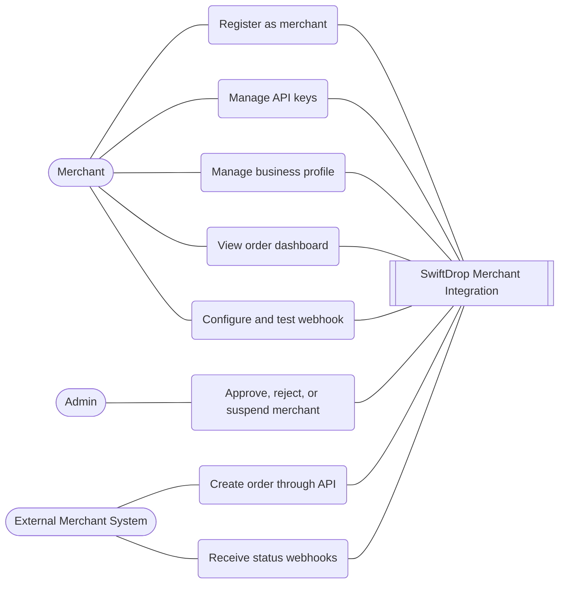
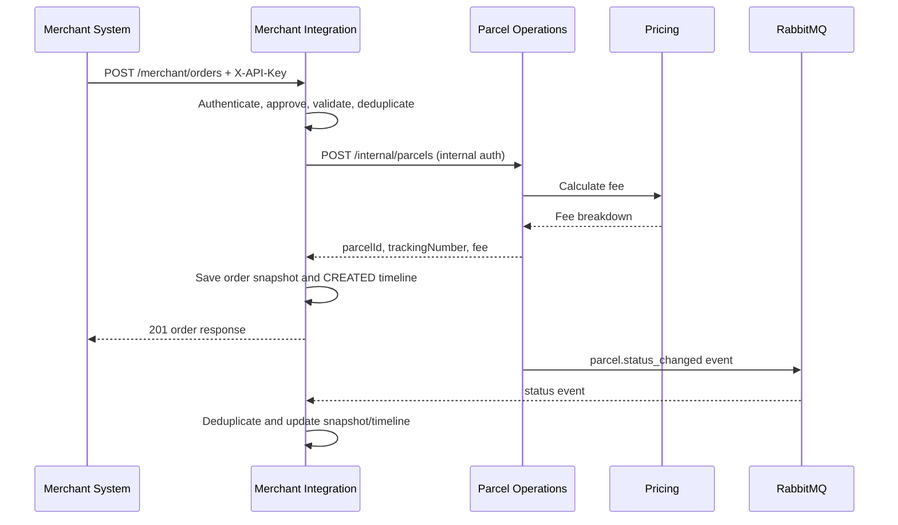

# Merchant Integration diagrams

## Figure 2 — Merchant use cases



## Figure 10 — Merchant order sequence



## Figure 11 — Merchant order activity

```mermaid
flowchart TD
  start((Start)) --> request[Receive order request]
  request --> auth{API key valid and merchant approved?}
  auth -- No --> error401[Return 401/403] --> end((End))
  auth -- Yes --> validate{Payload valid?}
  validate -- No --> error422[Return 422] --> end
  validate -- Yes --> duplicate{Duplicate request?}
  duplicate -- Same payload --> original[Return original order] --> end
  duplicate -- Conflicting payload --> error409[Return 409] --> end
  duplicate -- New --> pickup{Pickup supplied?}
  pickup -- No --> defaults[Use merchant defaults]
  pickup -- Yes --> parcel[Create parcel]
  defaults --> parcel
  parcel --> save[Save order snapshot and timeline]
  save --> success[Return 201] --> end
```
