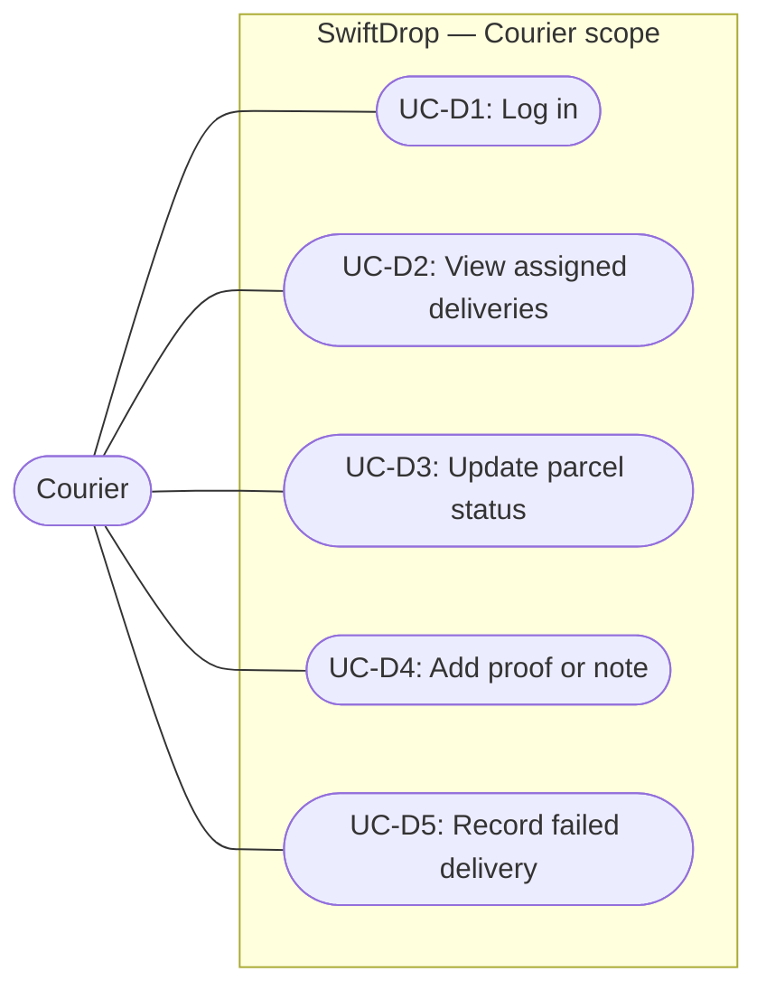
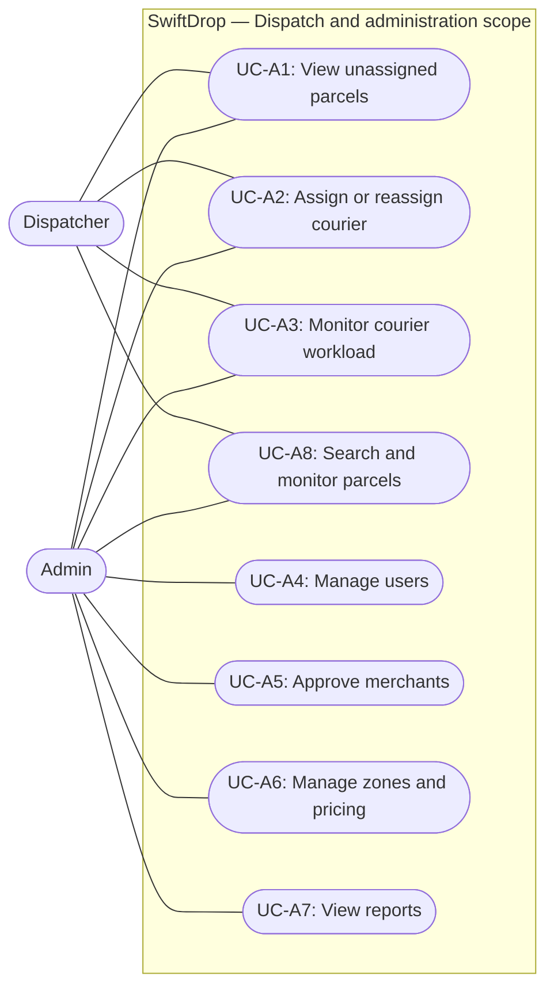
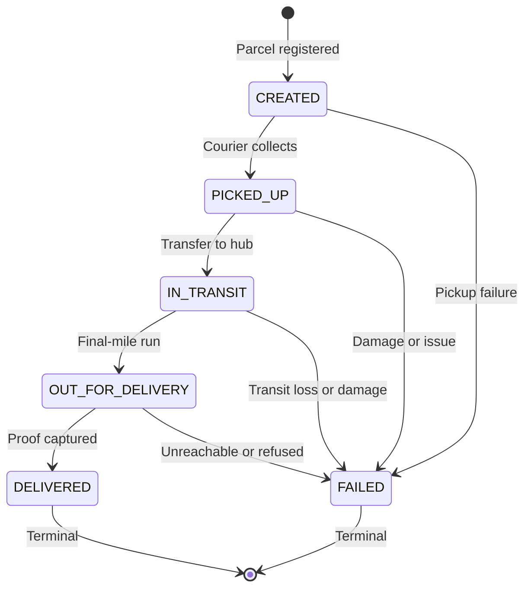

# SwiftDrop Design Report — Member 6 (Dispatch and Parcel State Machine)

**Author:** Member 6 (Dispatch and Courier Management)

**Specification baseline:** Design Report v1.1 and API Documentation v1.1

**Submission date:** November 1, 2026

This report is assembled from the section sources in this directory. Keep the section files and this document consistent when either changes.

## Scope and implementation status

Milestone 1 implements the parcel domain state machine, the dispatch assignment and outbox database foundations, and a preview of the dispatcher interface. It does not implement dispatch or courier HTTP handlers, an assignment repository, identity eligibility checks, an outbox writer or relay, or real-time status broadcasts. Planned work is marked as planned throughout this report.

| Deliverable                                                            | Status                             |
| :--------------------------------------------------------------------- | :--------------------------------- |
| Parcel status state machine and validation                             | Implemented                        |
| Parcel assignment and outbox migrations                                | Implemented                        |
| PostgreSQL assignment, status-trigger, history, and outbox constraints | Implemented                        |
| Dispatch database integration tests                                    | Implemented                        |
| Dispatch and courier HTTP endpoints                                    | Planned                            |
| Assignment repository and identity eligibility checks                  | Planned                            |
| Outbox writer, relay, and RabbitMQ producer                            | Planned                            |
| Dispatcher preview UI                                                  | Preview only; uses local demo data |

---

## 2.4 Courier Use Cases

**Actor:** Courier (`COURIER` role).

Couriers work in the field, view only the parcels currently assigned to them, move those parcels through the permitted lifecycle states, and record proof of delivery. Every courier endpoint requires authentication and enforces the assignment check before returning or changing a parcel. Figure 3 shows the courier use case diagram.

**Figure 3: Courier use case diagram.**

Table 2.4 lists the courier use cases and their API v1.1 endpoints.

### Table 2.4: Courier Use Cases

| ID      | Use case                 | Description                                                                                                                    | API        |
| :------ | :----------------------- | :----------------------------------------------------------------------------------------------------------------------------- | :--------- |
| `UC-D1` | Log in                   | Authenticate as a courier.                                                                                                     | `2.2`      |
| `UC-D2` | View assigned deliveries | See active deliveries plus deliveries finished on the selected day, including contacts and status history.                     | `6.1, 6.2` |
| `UC-D3` | Update parcel status     | Move an assigned parcel through Picked Up, In Transit, Out for Delivery, and Delivered. Delivered requires the recipient name. | `6.3`      |
| `UC-D4` | Add proof or note        | Record a recipient name, note, or a JPEG/PNG photo of at most 5 MB.                                                            | `6.4`      |
| `UC-D5` | Record failed delivery   | Mark the parcel Failed with a mandatory reason of 5 to 255 characters.                                                         | `6.3`      |

### Courier Operational Rules

1. **Ownership.** A courier may view or update only a parcel whose `current_courier_id` matches their authenticated user ID. Any other request returns `403 FORBIDDEN`.
2. **Status changes.** Only the assigned courier may change a parcel's status. Dispatchers and administrators manage assignments, not parcel lifecycle status.
3. **Transition validation.** The courier workflow must call the parcel state machine before persisting a change. Prohibited, backward, skipped, identical, and terminal transitions return `409 INVALID_TRANSITION`.
4. **Required delivery input.** `DELIVERED` requires a non-empty recipient name of at most 150 characters (`422 RECIPIENT_REQUIRED` when missing). `FAILED` requires a reason of 5 to 255 characters (`422 FAILURE_REASON_REQUIRED` when missing or out of range). An optional note is limited to 500 characters.
5. **Proof of delivery.** A proof may contain a recipient name, a note, or an optional JPEG/PNG photo. At least one field is required.
6. **Terminal states.** `DELIVERED` and `FAILED` are terminal. A terminal parcel cannot be reassigned or moved again.

### Implementation Status

The courier HTTP endpoints and proof storage are **planned** and are not implemented in Milestone 1. The parcel state machine in `apps/services/parcel/internal/statemachine` is implemented and is the shared validation entry point for the future courier handlers. Member 7's courier workflow must call `ValidateCourierTransition` rather than duplicating transition rules.

---

## 2.5 Dispatcher and Admin Use Cases

**Actors:** Dispatcher (`DISPATCHER` role) and Administrator (`ADMIN` role).

Dispatchers coordinate logistics operations: they inspect unassigned parcels, assign or reassign couriers, monitor courier workload, and monitor parcels. Administrators can perform the dispatch operations allowed by API v1.1 section 5 and additionally manage users, approve merchants, configure zones and pricing, and view reports. Figure 4 shows the dispatcher and administrator use case diagram.

**Figure 4: Dispatcher and administrator use case diagram.**

Table 2.5 lists the dispatcher and administrator use cases and their API v1.1 endpoints.

### Table 2.5: Dispatcher and Admin Use Cases

| ID      | Use case                   | Description                                                                                            | API            |
| :------ | :------------------------- | :----------------------------------------------------------------------------------------------------- | :------------- |
| `UC-A1` | View unassigned parcels    | List parcels with no current courier, filtered by pickup zone and date.                                | `5.1`          |
| `UC-A2` | Assign or reassign courier | Assign an active, available courier. Closed parcels cannot be assigned.                                | `2.15, 5.2`    |
| `UC-A3` | Monitor courier workload   | Show availability and active deliveries per courier, broken down by status.                            | `5.3`          |
| `UC-A4` | Manage users               | Create, edit, activate, and deactivate staff accounts (Admin).                                         | `2.10 to 2.14` |
| `UC-A5` | Approve merchants          | Approve, reject, or suspend merchants (Admin).                                                         | `8.4 to 8.8`   |
| `UC-A6` | Manage zones and pricing   | Manage zones, base fees, weight bands, and size surcharges (Admin).                                    | `3.3 to 3.12`  |
| `UC-A7` | View reports               | View deliveries per day, success and failure rates, and top failure reasons (Admin).                   | `7.1, 7.2`     |
| `UC-A8` | Search and monitor parcels | Search every parcel by status, courier, merchant, customer, or tracking number and watch live updates. | `5.4, 9.2`     |

### Dispatcher and Administrator Operational Rules

1. **Assignment endpoint.** Dispatchers and administrators assign or reassign a courier through `PUT /api/v1/dispatch/parcels/{parcelId}/assignment` (API 5.2). Eligibility is checked through the identity service (`GET /couriers`, API 2.15).
2. **Closed parcels.** A parcel in `DELIVERED` or `FAILED` cannot be assigned or reassigned (`409 PARCEL_CLOSED`).
3. **Status ownership.** Dispatchers and administrators do not change parcel lifecycle status. Status changes are reserved for the currently assigned courier (API 6.3).
4. **One current assignment.** The database enforces at most one current assignment per parcel with the partial unique index `assignments_one_current_uq`. Reassignment closes the previous row and inserts a new current row, preserving history.
5. **Workload visibility.** Courier workload queries use the `assignments_courier_idx (courier_id, is_current)` index.
6. **Authorization.** Every dispatch endpoint requires the `DISPATCHER` or `ADMIN` role. The dispatch preview in the web application simulates this role guard; the backend guard is not implemented yet.

### Implementation Status

The assignment and outbox database foundations are **implemented** in the parcel schema. The dispatch HTTP endpoints, the assignment repository, the identity eligibility check, and the outbox relay are **planned** and are not implemented in Milestone 1. The `/dispatch` web page is a preview that uses local demo data.

---

## 6.6 Parcel Status State Machine

The parcel lifecycle is a deterministic finite state machine. The domain rules live in `apps/services/parcel/internal/statemachine`, independent of HTTP handlers and database code. The PostgreSQL schema independently rejects invalid status changes through the `parcel.enforce_status_transition()` trigger.

### 6.6.1 Status Lifecycle

### 6.6.2 State Transition Matrix

Table 6.6 lists the permitted transitions and the input required for each destination state.

| Current status (`from`) | Allowed next status (`to`)   | Terminal? | Preconditions and required input                                                                                                        |
| :---------------------- | :--------------------------- | :-------- | :-------------------------------------------------------------------------------------------------------------------------------------- |
| `CREATED`               | `PICKED_UP`, `FAILED`        | No        | Parcel registered. `FAILED` requires a failure reason of 5 to 255 characters.                                                           |
| `PICKED_UP`             | `IN_TRANSIT`, `FAILED`       | No        | Courier has physical custody. `FAILED` requires a failure reason of 5 to 255 characters.                                                |
| `IN_TRANSIT`            | `OUT_FOR_DELIVERY`, `FAILED` | No        | Parcel is moving between facilities. `FAILED` requires a failure reason of 5 to 255 characters.                                         |
| `OUT_FOR_DELIVERY`      | `DELIVERED`, `FAILED`        | No        | Parcel is on its final-mile run. `DELIVERED` requires a non-empty recipient name of at most 150 characters. `FAILED` requires a reason. |
| `DELIVERED`             | None                         | Yes       | Successfully handed over. No further transitions are permitted.                                                                         |
| `FAILED`                | None                         | Yes       | Delivery aborted. No further transitions are permitted.                                                                                 |

### 6.6.3 Domain Validation

`ValidateTransition` implements the matrix and returns structured `statemachine.DomainError` values. `errors.Is` matches dynamic errors against the sentinel errors by API error code.

| Condition                                                              | Code                      | HTTP status |
| :--------------------------------------------------------------------- | :------------------------ | :---------- |
| Unknown or empty source or destination status                          | `VALIDATION_ERROR`        | 422         |
| Prohibited, backward, skipped, identical, or terminal-state transition | `INVALID_TRANSITION`      | 409         |
| `DELIVERED` without a non-empty recipient name                         | `RECIPIENT_REQUIRED`      | 422         |
| Recipient name longer than 150 characters                              | `VALIDATION_ERROR`        | 422         |
| `FAILED` without a reason of 5 to 255 characters                       | `FAILURE_REASON_REQUIRED` | 422         |
| Note longer than 500 characters                                        | `VALIDATION_ERROR`        | 422         |
| Assignment or reassignment of a terminal parcel                        | `PARCEL_CLOSED`           | 409         |
| Status update by a courier other than the assigned courier             | `FORBIDDEN`               | 403         |

Length limits are measured in Unicode code points, matching PostgreSQL `VARCHAR` semantics.

The package exposes:

- `AllStatuses()` and `AllowedNext(status)` as defensive copies of the canonical collections.
- `IsValidStatus`, `IsTerminal`, and `IsClosed`.
- `CanTransition` for transition checks without input validation.
- `ValidateTransition` for transition plus recipient, failure-reason, and note validation.
- `CanAssignCourier` for dispatch eligibility.
- `VerifyCourierOwnership` and `ValidateCourierTransition` for the courier workflow.

### 6.6.4 Database Alignment

The baseline migration `000002_tables` already creates the parcel tables. It also installs:

- `parcel.enforce_status_transition()`, a `BEFORE UPDATE OF status` trigger that raises SQLSTATE `23514` for any status change outside the matrix. A same-status `UPDATE` does not fire the trigger because it is not a transition.
- `parcel.forbid_history_change()`, an append-only trigger on `parcel.parcel_status_history`.
- `assignments_one_current_uq`, a partial unique index on `parcel.parcel_assignments (parcel_id) WHERE is_current`.
- `assignments_courier_idx`, a workload index on `parcel.parcel_assignments (courier_id, is_current)`.
- `outbox_status_created`, an index on `parcel.outbox_events (status, created_at)` for pending-event retrieval.

Migration `000003_dispatch_foundations` extends, but does not recreate, those tables:

- `parcel_assignments.previous_courier_id` records the courier replaced by a reassignment for API 5.2.
- `parcel_assignments.updated_at` and its `set_updated_at` trigger make assignment closure auditable.
- `outbox_events.aggregate_type` and `outbox_events.aggregate_id` let a future relay group events by aggregate, with `outbox_aggregate_pair` enforcing that both are set or both are null and `outbox_aggregate_idx` supporting aggregate queries.

### 6.6.5 Outbox Behavior

`parcel.outbox_events` is the transactional outbox foundation, not a RabbitMQ queue. Each row stores:

- `id`, which is also the event ID used for consumer idempotency.
- `event_type` and `routing_key`. API v1.1 section 11.3 uses `parcel.status_changed` as the event type and `parcel.status.changed` as the routing key; `outbox_type_key_pair` enforces the pairing.
- `payload`, a JSONB event body that must not contain addresses, phone numbers, tokens, or photos.
- `status` (`PENDING`, `PUBLISHED`, `FAILED`), `attempts`, `last_error`, `created_at`, and `published_at`.
- Optional aggregate metadata added by `000003_dispatch_foundations`.

The outbox writer, publisher, relay, and retry loop are **planned**. No producer publishes events in Milestone 1, and the current workers do not consume parcel events. The event envelope and versioned `contracts/events` conventions must be reconciled with API v1.1 before the relay is implemented.

### 6.6.6 Implementation Status

| Capability                                                     | Status      |
| :------------------------------------------------------------- | :---------- |
| Canonical statuses and transition matrix                       | Implemented |
| Domain transition, input, ownership, and assignment validation | Implemented |
| PostgreSQL status, assignment, and outbox schema               | Implemented |
| Database transition trigger and append-only history            | Implemented |
| Courier and dispatch HTTP handlers                             | Planned     |
| Assignment repository and identity eligibility check           | Planned     |
| Outbox writer, relay, and RabbitMQ producer                    | Planned     |
| Real-time status broadcasts                                    | Planned     |

### 6.6.7 Coordination with Other Members

- **Member 5 (parcel model):** the canonical status values are the database `parcels.status` values and the constants in `statemachine`. The parcel model must reuse those values and must not introduce a second status type.
- **Member 7 (courier workflow):** courier handlers should call `ValidateCourierTransition` before persisting a status change, then write the parcel update, the `parcel_status_history` row, and the outbox row in one transaction once that handler is implemented.
- **Dispatch:** assignment handlers should call `CanAssignCourier` before creating an assignment and must close the previous current assignment before inserting a new one.

---
