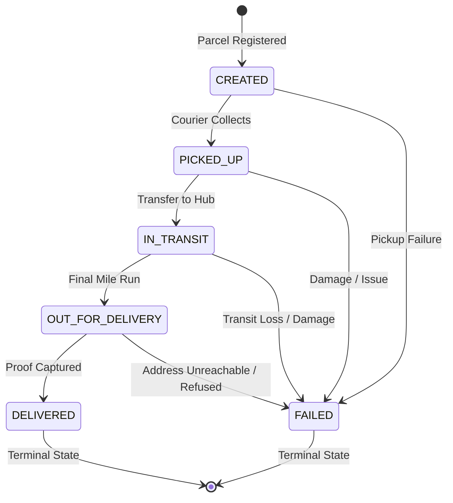

# SwiftDrop Design Report — Member 6 (Dispatch & Parcel State Machine)
**Author:** Member 6 (M6 - Dispatch & Courier Management)  
**Specification Baseline:** Design Report v1.1 & API Specification v1.1  
**Submission Date:** November 1, 2026  

---

## 2. System Overview and Actor Use Cases

### 2.4 Courier Use Cases

Couriers operate in the field using the mobile-optimized web application to fulfill assigned deliveries, record transitions in parcel status, and capture proof of delivery. Figure 3 illustrates the courier use case diagram.

```
+-----------------------------------------------------------------------------------+
| Figure 3: Courier Use Case Diagram                                                |
|                                                                                   |
|                   +--------------------------------------------+                  |
|                   |                  SwiftDrop                 |                  |
|                   |                                            |                  |
|                   |   ( UC-D1: Log in )                        |                  |
|                   |                                            |                  |
|                   |   ( UC-D2: View assigned deliveries )      |                  |
|   +-----------+   |                                            |                  |
|   |  Courier  |---+   ( UC-D3: Update parcel status )          |                  |
|   +-----------+   |                                            |                  |
|                   |   ( UC-D4: Add proof or note )             |                  |
|                   |                                            |                  |
|                   |   ( UC-D5: Record failed delivery )        |                  |
|                   +--------------------------------------------+                  |
+-----------------------------------------------------------------------------------+
```

Table 2.4 details the primary use cases for the Courier actor and their corresponding API v1.1 endpoints.

#### Table 2.4: Courier Use Cases

| ID | Use case | Description | API |
| :--- | :--- | :--- | :--- |
| `UC-D1` | Log in | Authenticate as a courier | `2.2` |
| `UC-D2` | View assigned deliveries | See active deliveries plus those finished on the selected day, with contacts and history | `6.1, 6.2` |
| `UC-D3` | Update parcel status | Move a parcel through Picked Up, In Transit, Out for Delivery and Delivered. Delivered needs the recipient name | `6.3` |
| `UC-D4` | Add proof or note | Recipient name, note or a JPEG or PNG photo up to 5 MB | `6.4` |
| `UC-D5` | Record failed delivery | Mark Failed with a mandatory reason of 5 to 255 characters | `6.3` |

---

### 2.5 Dispatcher and Admin Use Cases

Dispatchers coordinate logistics operations, monitor courier availability, balance active workloads, and assign parcels to field couriers. System Administrators maintain overall platform health, configure zones, set tariff structures, manage staff accounts, and audit platform activities. Figure 4 illustrates the Dispatcher and Admin use case diagram.

```
+-----------------------------------------------------------------------------------+
| Figure 4: Dispatcher and Admin Use Case Diagram                                   |
|                                                                                   |
|                   +--------------------------------------------+                  |
|                   |                  SwiftDrop                 |                  |
|                   |                                            |                  |
|                   |   ( UC-A1: View unassigned parcels )       |                  |
|   +------------+  |                                            |                  |
|   | Dispatcher |--+-- ( UC-A2: Assign or reassign courier )    |                  |
|   +------------+  |                                            |                  |
|         ^         |   ( UC-A3: Monitor courier workload )      |                  |
|         |         |                                            |                  |
|         |         |   ( UC-A8: Search and monitor parcels )    |                  |
|         |         |                                            |                  |
|   +------------+  |   ( UC-A4: Manage users )                  |                  |
|   |   Admin    |--+                                            |                  |
|   +------------+  |   ( UC-A5: Approve merchants )             |                  |
|                   |                                            |                  |
|                   |   ( UC-A6: Manage zones and pricing )      |                  |
|                   |                                            |                  |
|                   |   ( UC-A7: View reports )                  |                  |
|                   +--------------------------------------------+                  |
+-----------------------------------------------------------------------------------+
```

Table 2.5 details the use cases for Dispatcher and Admin actors and their corresponding API v1.1 endpoints.

#### Table 2.5: Dispatcher and Admin Use Cases

| ID | Use case | Description | API |
| :--- | :--- | :--- | :--- |
| `UC-A1` | View unassigned parcels | List parcels with no courier, filtered by pickup zone and date | `5.1` |
| `UC-A2` | Assign or reassign courier | Assign an active, available courier. Closed parcels cannot be assigned | `2.15, 5.2` |
| `UC-A3` | Monitor courier workload | Availability and active deliveries per courier, by status | `5.3` |
| `UC-A4` | Manage users | Create staff accounts, edit, activate and deactivate users (Admin) | `2.10 to 2.14` |
| `UC-A5` | Approve merchants | Approve, reject or suspend merchants (Admin) | `8.4 to 8.8` |
| `UC-A6` | Manage zones and pricing | Zones, base fees, weight bands and size surcharges (Admin) | `3.3 to 3.12` |
| `UC-A7` | View reports | Deliveries per day, success and failure rates, top failure reasons | `7.1, 7.2` |
| `UC-A8` | Search and monitor parcels | Search every parcel by status, courier, merchant, customer or tracking number, and watch all live updates | `5.4, 9.2` |

---

## 6. Detailed Design and Implementation

### 6.6 Parcel Status State Machine

The parcel lifecycle is governed by a deterministic finite state machine implemented within the Parcel Operations service (`apps/services/parcel/internal/statemachine`) and enforced at both the application domain and database schema levels.

#### 6.6.1 Status Lifecycle Diagram



#### 6.6.2 State Transition Matrix

Table 6.6 specifies the valid transitions, terminal states, and transition prerequisites:

| Current Status (`from`) | Allowed Next Status (`to`) | Terminal? | Pre-conditions and Required Input |
| :--- | :--- | :--- | :--- |
| `CREATED` | `PICKED_UP`, `FAILED` | No | Parcel registered and assigned to courier. For `FAILED`, `failure_reason` (5–255 chars) is mandatory. |
| `PICKED_UP` | `IN_TRANSIT`, `FAILED` | No | Courier has accepted physical custody. For `FAILED`, `failure_reason` (5–255 chars) is mandatory. |
| `IN_TRANSIT` | `OUT_FOR_DELIVERY`, `FAILED` | No | Parcel transported between facilities. For `FAILED`, `failure_reason` (5–255 chars) is mandatory. |
| `OUT_FOR_DELIVERY` | `DELIVERED`, `FAILED` | No | Parcel on final-mile delivery run. For `DELIVERED`, `recipient_name` (non-empty, max 150 chars) is mandatory. For `FAILED`, `failure_reason` (5–255 chars) is mandatory. |
| `DELIVERED` | None | Yes | Successfully handed over to recipient. No further transitions permitted. |
| `FAILED` | None | Yes | Delivery aborted due to failure condition. No further transitions permitted. |

#### 6.6.3 Business and Validation Rules

1. **Role and Ownership Enforcement (API 6.3):**
   - **Only the courier currently assigned to the parcel (`parcel.current_courier_id == actor_user_id`) can change its status (API 6.3)**.
   - Dispatchers and admins manage courier assignments (`POST /api/v1/dispatch/assign`), but **cannot change parcel status**. Any attempt by an unassigned courier, customer, merchant, or dispatcher to trigger a status transition returns HTTP `403 FORBIDDEN`.

2. **Transition Validation Rules:**
   - Any attempt to transition outside the permitted paths (e.g., `CREATED -> DELIVERED`, backward step `IN_TRANSIT -> PICKED_UP`, or self-transition `IN_TRANSIT -> IN_TRANSIT`) returns HTTP `409 INVALID_TRANSITION`.
   - Any transition out of a terminal state (`DELIVERED` or `FAILED`) returns HTTP `409 INVALID_TRANSITION`.
   - Transitioning to `DELIVERED` requires a valid non-empty `recipient_name` (up to 150 characters). Missing or whitespace-only recipient returns HTTP `422 RECIPIENT_REQUIRED`.
   - Transitioning to `FAILED` requires a descriptive `failure_reason` between 5 and 255 characters. Missing, whitespace-only, or length-violating reason returns HTTP `422 FAILURE_REASON_REQUIRED`.
   - An optional `note` is supported up to 500 characters. Exceeding 500 characters returns HTTP `422 VALIDATION_ERROR`.

3. **Courier Assignment Eligibility (API 5.2):**
   - A parcel in `DELIVERED` or `FAILED` status is considered closed (`IsClosed() == true`).
   - A `DELIVERED` or `FAILED` parcel **cannot be assigned or reassigned** to any courier. Attempting to assign a closed parcel returns HTTP `409 PARCEL_CLOSED`.

4. **Database & Architecture Alignment:**
   - Enforced by PostgreSQL triggers (`parcel.enforce_status_transition()`) and append-only constraints on `parcel.parcel_status_history`.
   - Courier assignment uniqueness is strictly enforced via partial unique index `idx_parcel_assignments_one_current ON parcel.parcel_assignments(parcel_id) WHERE is_current = TRUE`.
   - Courier workload queries (`GET /api/v1/dispatch/workload`) are accelerated via partial index `idx_parcel_assignments_courier_workload ON parcel.parcel_assignments(courier_id) WHERE is_current = TRUE`.
   - Transactional outbox events are persisted in `parcel.outbox_events` and indexed for both pending worker dispatch (`WHERE published_at IS NULL`) and 14-day retention purging.

