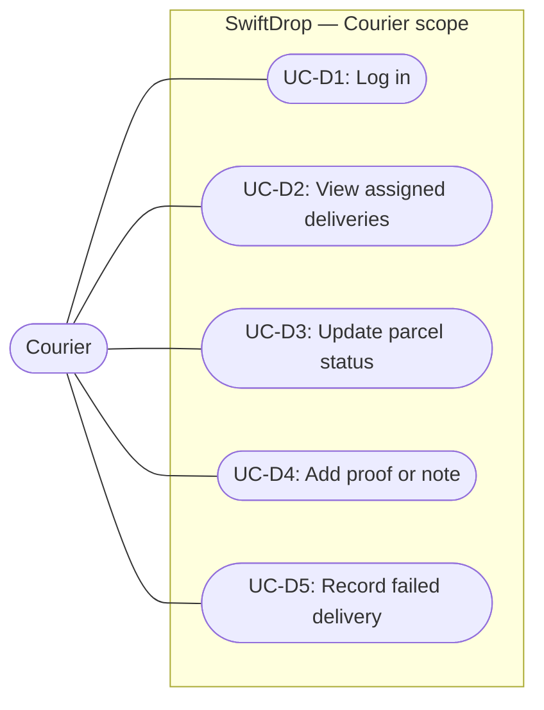

## 2.4 Courier Use Cases

**Actor:** Courier (`COURIER` role).

Couriers work in the field, view only the parcels currently assigned to them, move those parcels through the permitted lifecycle states, and record proof of delivery. Every courier endpoint requires authentication and enforces the assignment check before returning or changing a parcel. Figure 3 shows the courier use case diagram.

**Figure 3: Courier use case diagram.**

Table 2.4 lists the courier use cases and their API v1.1 endpoints.

### Table 2.4: Courier Use Cases

| ID      | Use case                 | Description                                                                                                                    | API        |
| :------ | :----------------------- | :----------------------------------------------------------------------------------------------------------------------------- | :--------- |
| `UC-D1` | Log in                   | Authenticate as a courier.                                                                                                     | `2.2`      |
| `UC-D2` | View assigned deliveries | See active deliveries plus deliveries finished on the selected day, including contacts and status history.                     | `6.1, 6.2` |
| `UC-D3` | Update parcel status     | Move an assigned parcel through Picked Up, In Transit, Out for Delivery, and Delivered. Delivered requires the recipient name. | `6.3`      |
| `UC-D4` | Add proof or note        | Record a recipient name, note, or a JPEG/PNG photo of at most 5 MB.                                                            | `6.4`      |
| `UC-D5` | Record failed delivery   | Mark the parcel Failed with a mandatory reason of 5 to 255 characters.                                                         | `6.3`      |

### Courier Operational Rules

1. **Ownership.** A courier may view or update only a parcel whose `current_courier_id` matches their authenticated user ID. Any other request returns `403 FORBIDDEN`.
2. **Status changes.** Only the assigned courier may change a parcel's status. Dispatchers and administrators manage assignments, not parcel lifecycle status.
3. **Transition validation.** The courier workflow must call the parcel state machine before persisting a change. Prohibited, backward, skipped, identical, and terminal transitions return `409 INVALID_TRANSITION`.
4. **Required delivery input.** `DELIVERED` requires a non-empty recipient name of at most 150 characters (`422 RECIPIENT_REQUIRED` when missing). `FAILED` requires a reason of 5 to 255 characters (`422 FAILURE_REASON_REQUIRED` when missing or out of range). An optional note is limited to 500 characters.
5. **Proof of delivery.** A proof may contain a recipient name, a note, or an optional JPEG/PNG photo. At least one field is required.
6. **Terminal states.** `DELIVERED` and `FAILED` are terminal. A terminal parcel cannot be reassigned or moved again.

### Implementation Status

The courier HTTP endpoints and proof storage are **planned** and are not implemented in Milestone 1. The parcel state machine in `apps/services/parcel/internal/statemachine` is implemented and is the shared validation entry point for the future courier handlers. Member 7's courier workflow must call `ValidateCourierTransition` rather than duplicating transition rules.
