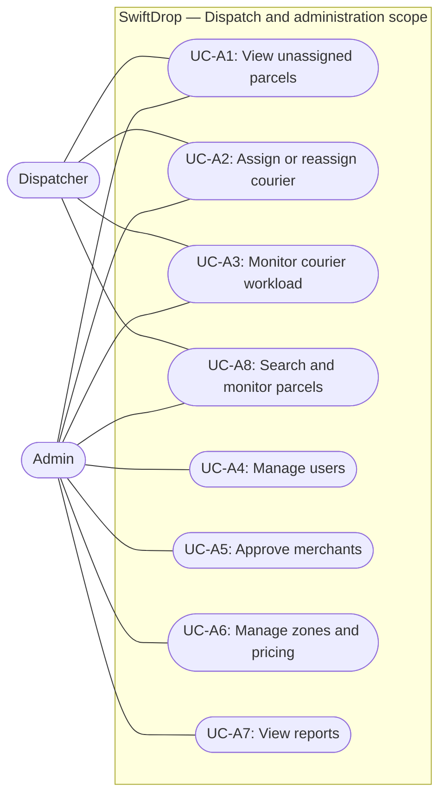

## 2.5 Dispatcher and Admin Use Cases

**Actors:** Dispatcher (`DISPATCHER` role) and Administrator (`ADMIN` role).

Dispatchers coordinate logistics operations: they inspect unassigned parcels, assign or reassign couriers, monitor courier workload, and monitor parcels. Administrators can perform the dispatch operations allowed by API v1.1 section 5 and additionally manage users, approve merchants, configure zones and pricing, and view reports. Figure 4 shows the dispatcher and administrator use case diagram.

**Figure 4: Dispatcher and administrator use case diagram.**

Table 2.5 lists the dispatcher and administrator use cases and their API v1.1 endpoints.

### Table 2.5: Dispatcher and Admin Use Cases

| ID      | Use case                   | Description                                                                                            | API            |
| :------ | :------------------------- | :----------------------------------------------------------------------------------------------------- | :------------- |
| `UC-A1` | View unassigned parcels    | List parcels with no current courier, filtered by pickup zone and date.                                | `5.1`          |
| `UC-A2` | Assign or reassign courier | Assign an active, available courier. Closed parcels cannot be assigned.                                | `2.15, 5.2`    |
| `UC-A3` | Monitor courier workload   | Show availability and active deliveries per courier, broken down by status.                            | `5.3`          |
| `UC-A4` | Manage users               | Create, edit, activate, and deactivate staff accounts (Admin).                                         | `2.10 to 2.14` |
| `UC-A5` | Approve merchants          | Approve, reject, or suspend merchants (Admin).                                                         | `8.4 to 8.8`   |
| `UC-A6` | Manage zones and pricing   | Manage zones, base fees, weight bands, and size surcharges (Admin).                                    | `3.3 to 3.12`  |
| `UC-A7` | View reports               | View deliveries per day, success and failure rates, and top failure reasons (Admin).                   | `7.1, 7.2`     |
| `UC-A8` | Search and monitor parcels | Search every parcel by status, courier, merchant, customer, or tracking number and watch live updates. | `5.4, 9.2`     |

### Dispatcher and Administrator Operational Rules

1. **Assignment endpoint.** Dispatchers and administrators assign or reassign a courier through `PUT /api/v1/dispatch/parcels/{parcelId}/assignment` (API 5.2). Eligibility is checked through the identity service (`GET /couriers`, API 2.15).
2. **Closed parcels.** A parcel in `DELIVERED` or `FAILED` cannot be assigned or reassigned (`409 PARCEL_CLOSED`).
3. **Status ownership.** Dispatchers and administrators do not change parcel lifecycle status. Status changes are reserved for the currently assigned courier (API 6.3).
4. **One current assignment.** The database enforces at most one current assignment per parcel with the partial unique index `assignments_one_current_uq`. Reassignment closes the previous row and inserts a new current row, preserving history.
5. **Workload visibility.** Courier workload queries use the `assignments_courier_idx (courier_id, is_current)` index.
6. **Authorization.** Every dispatch endpoint requires the `DISPATCHER` or `ADMIN` role. The dispatch preview in the web application simulates this role guard; the backend guard is not implemented yet.

### Implementation Status

The assignment and outbox database foundations are **implemented** in the parcel schema. The dispatch HTTP endpoints, the assignment repository, the identity eligibility check, and the outbox relay are **planned** and are not implemented in Milestone 1. The `/dispatch` web page is a preview that uses local demo data.
