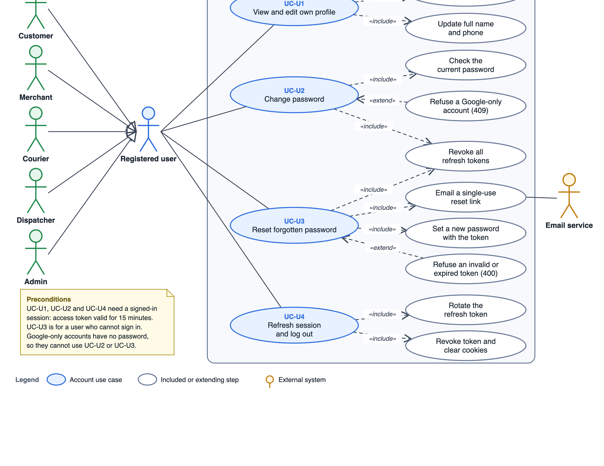
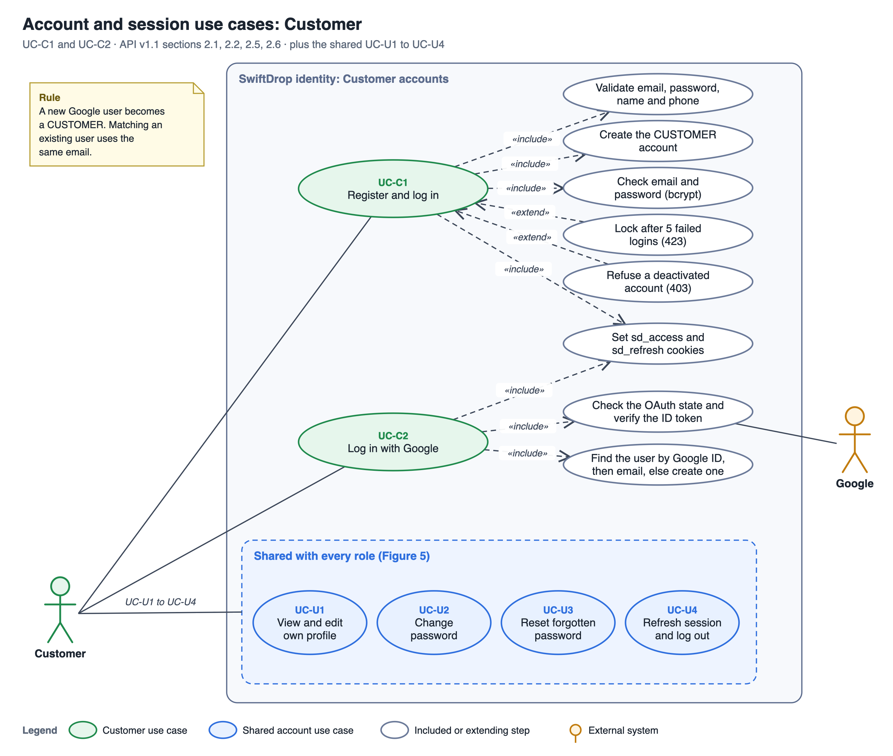
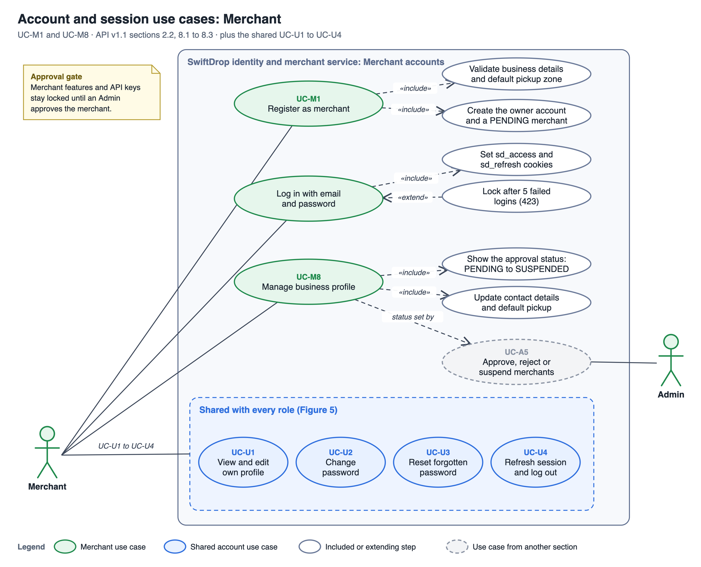
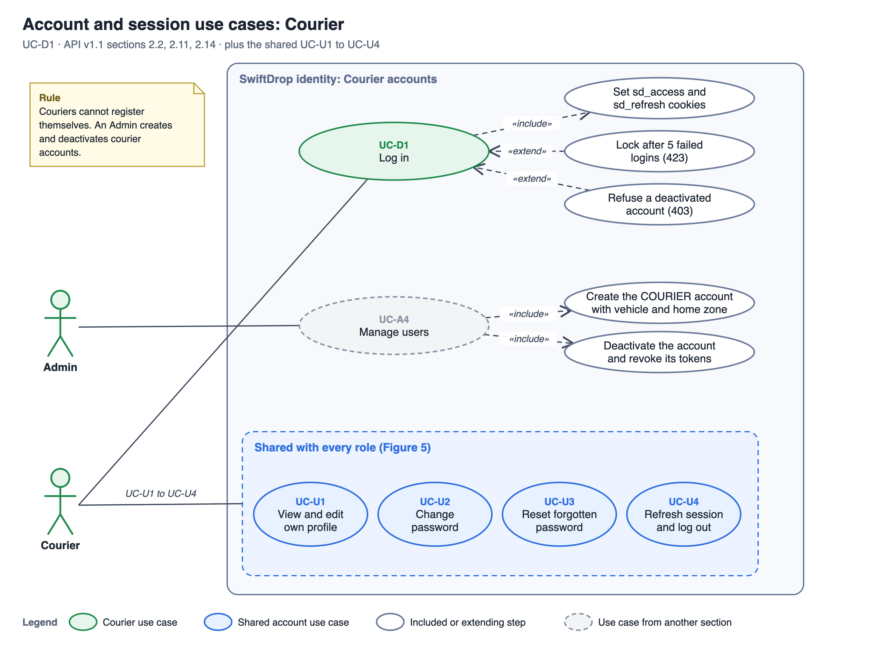
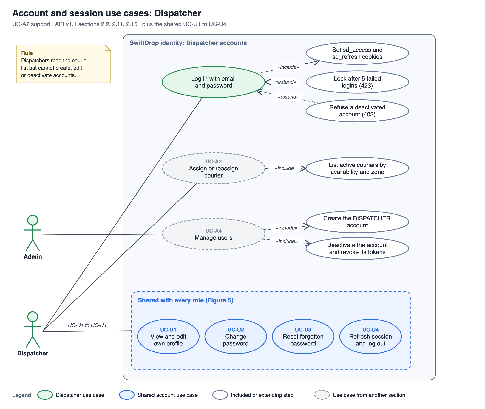
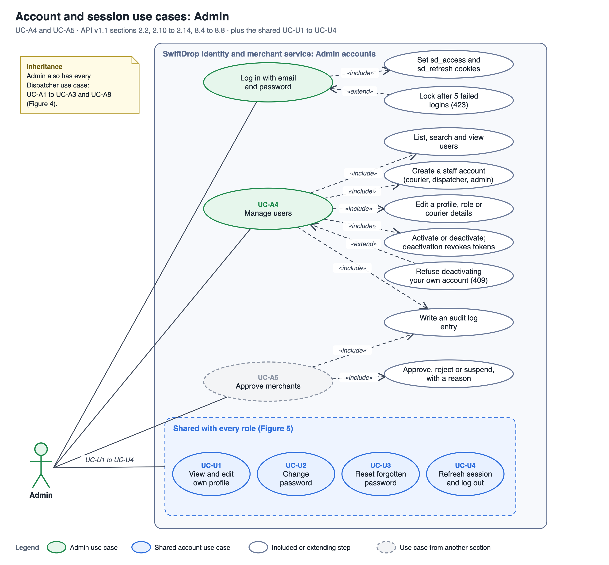

## 2.6 Account Use Cases (Every Signed-In Role)

**Actors:** Registered user (a Customer, Merchant, Courier, Dispatcher or Admin), Email service (external) and Google (external, Customer sign-in only).

Every SwiftDrop role owns an account in the Identity service. Four use cases are identical for all roles, so they are described once here: viewing and editing the profile, changing the password, resetting a forgotten password, and keeping the session alive until logging out. Sign-in and registration are role specific and stay in Sections 2.2 to 2.5 (UC-C1, UC-C2, UC-D1, UC-M1 and UC-A4). Figure 5 shows the shared use cases. Figures 5a to 5e show how each of the five roles reaches them.

**Figure 5. Account use case diagram.** The five roles generalise to one Registered user, who owns UC-U1 to UC-U4. The Email service receives the reset link in UC-U3. Draw.io source: [figure-5-account-use-cases.drawio](../diagrams/figure-5-account-use-cases.drawio).

### Table 2.6: Account Use Cases

| ID      | Use case                    | Description                                                                                                                                | API          | Data                                        | Build status (1 Nov 2026) |
| :------ | :-------------------------- | :----------------------------------------------------------------------------------------------------------------------------------------- | :----------- | :------------------------------------------ | :------------------------ |
| `UC-U1` | View and edit own profile   | See your role and sign-in provider. Update your full name and phone. Email and role cannot be changed here.                                | `2.7, 2.8`   | `identity.users`                            | Planned (M2.4)            |
| `UC-U2` | Change password             | Replace the password of a local account after proving the current one. All refresh tokens of the user are revoked.                         | `2.9`        | `identity.users`, `identity.refresh_tokens` | Planned (M2.4)            |
| `UC-U3` | Reset forgotten password    | Request a single-use reset link by email, then set a new password from the link. All refresh tokens of the user are revoked.               | `2.16, 2.17` | `identity.password_reset_tokens`            | Planned (M3.3)            |
| `UC-U4` | Refresh session and log out | Exchange the refresh token for a new access token (the refresh token is rotated), and end the session by revoking it and clearing cookies. | `2.3, 2.4`   | `identity.refresh_tokens`                   | Implemented               |

### UC-U1 View and edit own profile

- **Precondition:** signed in. **Endpoints:** `GET /users/me`, `PATCH /users/me`.
- **Flow:** the profile page loads `GET /users/me` and shows id, email, full name, phone, role, sign-in provider (`LOCAL` or `GOOGLE`) and creation date. The user edits full name (2 to 150 characters) or phone (E.164) and the page sends only the changed fields in `PATCH /users/me`.
- **Rules:** the request accepts only `fullName` and `phone`, so a user can never change their own email, role or active state. Those belong to the Admin (UC-A4).
- **Failures:** `422 VALIDATION_ERROR` with the field name and a safe message; `401` when the session is missing or expired.

### UC-U2 Change password

- **Precondition:** signed in with a local account (a password exists). **Endpoint:** `PUT /users/me/password`.
- **Flow:** the user sends the current and the new password. The service checks the current password, applies the same strength rule as registration (at least 8 characters with upper case, lower case and a digit, at most 72 bytes), stores a new bcrypt hash and revokes every refresh token of the user in one transaction. The response is `204`.
- **Rules:** other devices lose their session as soon as their access token expires (15 minutes at most). The web app sends the user to the login page straight away.
- **Failures:** `401 INVALID_CREDENTIALS` for a wrong current password, `409 PASSWORD_NOT_SET` for a Google-only account (it has no password to change), `422 VALIDATION_ERROR` for a weak new password.

### UC-U3 Reset forgotten password

- **Precondition:** none. The user cannot sign in. **Endpoints:** `POST /auth/forgot-password`, `POST /auth/reset-password`.
- **Flow:** the user enters an email on the login page. The Identity service answers `202` with the same message whether or not the account exists. For a local account it creates a random token, stores only its SHA-256 hash with a 30 minute expiry, marks older unused tokens as used, and emails a link built from the configured frontend URL. The reset page reads the token from the link and sends it with the new password. The service checks hash, expiry and unused state, then in one transaction updates the password, marks the token used and revokes every refresh token.
- **Rules:** a token works once and only the newest link works. Google-only accounts get no token. The link, the token and the email address are never written to logs or API responses.
- **Failures:** `400 INVALID_OR_EXPIRED_RESET_TOKEN` (one generic message for invalid, expired and used tokens), `422 VALIDATION_ERROR`, `429 RATE_LIMITED`.

### UC-U4 Refresh session and log out

- **Precondition:** a signed-in session. **Endpoints:** `POST /auth/refresh`, `POST /auth/logout`.
- **Flow:** the access token lasts 15 minutes. When a call returns `401 TOKEN_EXPIRED` the web app calls `POST /auth/refresh`. The browser sends the `sd_refresh` cookie, the service revokes that refresh token, issues a new one and a new access token, and sets both cookies again. Logging out revokes the caller's current refresh token and clears both cookies (`204`).
- **Rules:** a refresh token is single use. Reusing a rotated, expired or revoked token returns `401 REFRESH_TOKEN_INVALID` and clears the cookies. Logout never fails because the refresh token is missing, and it can revoke only the caller's own token. API tools may send `X-Token-Mode: body` to receive and send tokens in JSON instead of cookies.
- **Failures:** `401 REFRESH_TOKEN_INVALID`; `401 UNAUTHENTICATED` or `TOKEN_EXPIRED` for logout without a valid access token.

### Account Use Cases by Role

Each role has a different way to get an account and to sign in, and the same four shared use cases afterwards. Table 2.6.1 summarises it, and Figures 5a to 5e show each role in detail.

### Table 2.6.1: Accounts by Role

| Role       | How the account is created                                                        | How the user signs in                                                  | Role-specific use cases (Section)                           | Figure |
| :--------- | :-------------------------------------------------------------------------------- | :--------------------------------------------------------------------- | :---------------------------------------------------------- | :----- |
| Customer   | Self-registration (`2.1`) or first Google sign-in, which creates a `CUSTOMER`.    | Email and password (`2.2`) or Google (`2.5`, `2.6`).                   | `UC-C1`, `UC-C2` (2.2)                                      | 5a     |
| Merchant   | Merchant registration (`8.1`) creates the owner account and a `PENDING` merchant. | Email and password (`2.2`). Merchant features wait for Admin approval. | `UC-M1`, `UC-M8` (2.3), approval by `UC-A5` (2.5)           | 5b     |
| Courier    | Created by an Admin with a courier profile (`2.11`). No self-registration.        | Email and password (`2.2`).                                            | `UC-D1` (2.4), creation by `UC-A4` (2.5)                    | 5c     |
| Dispatcher | Created by an Admin (`2.11`). No self-registration.                               | Email and password (`2.2`). Can read the courier list (`2.15`).        | `UC-A2` (2.5), creation by `UC-A4` (2.5)                    | 5d     |
| Admin      | The first Admin is seeded. Other Admins are created by an Admin (`2.11`).         | Email and password (`2.2`).                                            | `UC-A4`, `UC-A5` (2.5). Includes every Dispatcher use case. | 5e     |

Rules that apply to every role:

- **Roles are fixed:** a role is set when the account is created and only an Admin can change it (`2.13`). The role is read from the signed access token on every request.
- **Account states:** an account is active, locked or deactivated. Five wrong passwords lock it for 15 minutes (`423 ACCOUNT_LOCKED`). A deactivated account returns `403 ACCOUNT_DISABLED` once the correct password is given and all its refresh tokens are revoked.
- **Same error for bad sign-in:** an unknown email and a wrong password return the same `401 INVALID_CREDENTIALS`, so the response does not reveal which accounts exist.

**Figure 5a. Account and session use cases: Customer.** UC-C1 registers or signs in with email and password; UC-C2 signs in through Google, which verifies the identity only. The SwiftDrop session is always the cookie pair issued by the Identity service. Source: [figure-5a-customer-account-use-cases.drawio](../diagrams/figure-5a-customer-account-use-cases.drawio).

**Figure 5b. Account and session use cases: Merchant.** UC-M1 creates the owner account and a `PENDING` merchant. The status shown in UC-M8 is set by the Admin in UC-A5. Source: [figure-5b-merchant-account-use-cases.drawio](../diagrams/figure-5b-merchant-account-use-cases.drawio).

**Figure 5c. Account and session use cases: Courier.** A courier only signs in (UC-D1). The account itself is created and deactivated by an Admin in UC-A4. Source: [figure-5c-courier-account-use-cases.drawio](../diagrams/figure-5c-courier-account-use-cases.drawio).

**Figure 5d. Account and session use cases: Dispatcher.** Besides signing in, the dispatcher uses the Identity service's courier list (`GET /couriers`) inside UC-A2. Source: [figure-5d-dispatcher-account-use-cases.drawio](../diagrams/figure-5d-dispatcher-account-use-cases.drawio).

**Figure 5e. Account and session use cases: Admin.** UC-A4 manages every account and each change writes an audit log entry. UC-A5 decides merchant approval. Source: [figure-5e-admin-account-use-cases.drawio](../diagrams/figure-5e-admin-account-use-cases.drawio).
