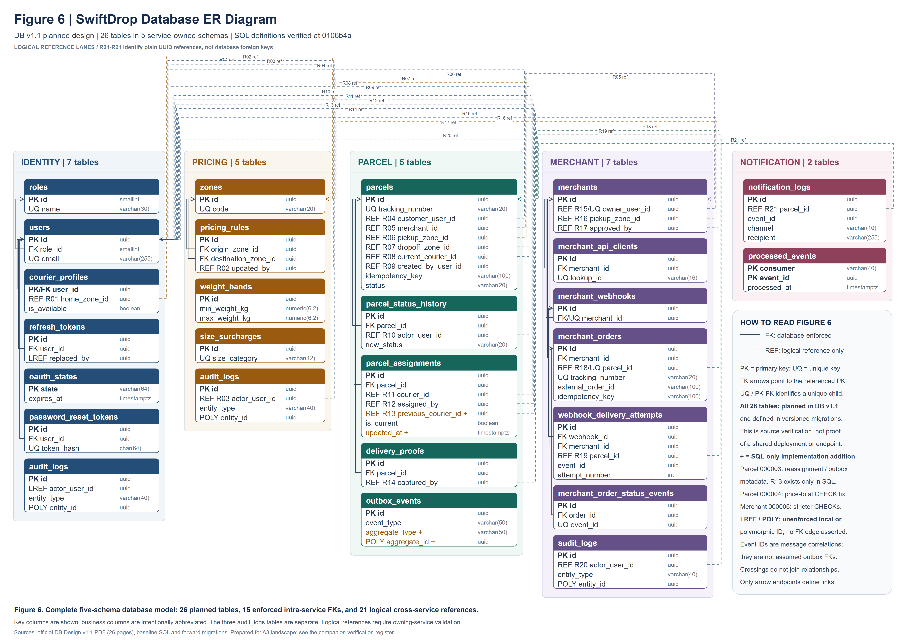

# 3. Data Model

This section describes the database design of SwiftDrop using the **SwiftDrop Database Design Document — Version 1.1 (aligned with API v1.1)** as the planned specification. The repository migrations and Figure 6 distinguish that design from the SQL definitions present at revision `0106b4a`. A table defined by a migration is not, by itself, evidence that it is deployed in a shared database or used by a completed business workflow.

## 3.1 Key modelling decisions

### 3.1.1 Database architecture and service ownership

SwiftDrop uses PostgreSQL 16 as its relational persistence platform. Local development uses one database instance with five service-owned schemas: `identity`, `pricing`, `parcel`, `merchant` and `notification`. Schema separation establishes ownership without requiring five database servers. Each service is responsible for its own writes; information owned by another service is obtained through REST APIs or RabbitMQ events rather than direct access to that service's tables (DB v1.1, §§1–2).

Local transactions provide consistency within an owning service. For example, a parcel change, its status-history record and the corresponding outbox entry are designed to commit together. The outbox supports later asynchronous publication, but the existence of its table does not establish that a relay or event-producing business handler is implemented. Realtime and the Webhook Worker own no tables in this 26-table design; the Webhook Worker records delivery attempts through the Merchant service's internal API.

### 3.1.2 Table inventory and audit ownership

All 26 planned tables have corresponding creation statements in their schema's `000002_tables.up.sql` baseline and matching rollback definitions. The three `audit_logs` instances are separate physical tables, not a shared audit table. Each owning service writes its own audit records.

| Schema and owner | Planned tables with verified SQL definitions | Count |
| --- | --- | ---: |
| `identity` — Identity and User service | `roles`; `users`; `courier_profiles`; `refresh_tokens`; `oauth_states`; `audit_logs`; `password_reset_tokens` | 7 |
| `pricing` — Pricing and Zones service | `zones`; `pricing_rules`; `weight_bands`; `size_surcharges`; `audit_logs` | 5 |
| `parcel` — Parcel Operations service | `parcels`; `parcel_status_history`; `parcel_assignments`; `delivery_proofs`; `outbox_events` | 5 |
| `merchant` — Merchant Integration service | `merchants`; `merchant_api_clients`; `merchant_webhooks`; `merchant_orders`; `webhook_delivery_attempts`; `merchant_order_status_events`; `audit_logs` | 7 |
| `notification` — Notification Worker | `notification_logs`; `processed_events` | 2 |
| **Total** | **Five schemas; three distinct `audit_logs` tables** | **26** |

Migration bookkeeping tables are infrastructure and are excluded from this inventory. The inspection confirms repository definitions; the current applied state of a shared or production database was not inspected.

### 3.1.3 Keys and relationships

Most entities use a UUID primary key named `id`. The PDF specifies application-generated UUIDs, while the baseline also supplies `gen_random_uuid()` defaults as a database fallback. The documented exceptions are `identity.roles.id` (`SMALLINT`), `identity.courier_profiles.user_id` (a shared primary key and foreign key), `identity.oauth_states.state` (`VARCHAR(64)`), and the composite `(consumer, event_id)` key of `notification.processed_events`. Timestamps use `TIMESTAMPTZ`; monetary values use exact `NUMERIC(12,2)` values with LKR as the documented default.

The migration chain declares 15 actual foreign keys: four in Identity, two in Pricing, three in Parcel and six in Merchant. None crosses a service schema. Unique keys make a courier profile optional and singular for a user, a webhook optional and singular for a merchant, and a merchant order unique for its linked parcel. A parent can exist before its child rows; a foreign key alone does not create a parcel's initial history entry.

The planned design uses 20 column-level cross-service UUID references. M6's migration adds `previous_courier_id`, giving 21 references in the implementation-aware Figure 6. These include parcel owners, couriers, zones, record creators and merchant order links. They are not database foreign keys; owning-service validation belongs to the application workflow. Event identifiers are correlation and deduplication values, not automatically foreign keys to the outbox. Audit entity identifiers and outbox aggregate identifiers are polymorphic and have no fixed target asserted by the diagram.

### 3.1.4 Integrity constraints and reporting indexes

Parcel ownership is enforced by an exclusive-or CHECK: exactly one of `customer_user_id` and `merchant_id` must be populated. Partial unique indexes enforce `(customer_user_id, idempotency_key)` and `(merchant_id, external_order_id)` when the relevant values are present. Tracking numbers are unique, and their prefix must match the owner category. Replay/conflicting-payload response behaviour remains an application responsibility.

Allowed parcel statuses are constrained, and a database trigger rejects invalid transitions. `DELIVERED` requires `delivered_at` and `delivered_to_name`; `FAILED` requires `failed_at` and a reason of at least five characters. Status history references its parcel and is append-only. A partial unique assignment index permits at most one current courier per parcel, and a closed assignment requires `unassigned_at`. The application must coordinate parcel, history, assignment and outbox writes within the appropriate transaction.

Pricing rules permit one active rule per origin/destination zone pair. Active weight bands are protected against overlap by an exclusion constraint. Monetary and weight checks protect the relevant nonnegative or positive values. Parcel migration `000004` requires the stored price-total expression to evaluate to TRUE, preventing JSON-null components from bypassing the PDF's requirement that the total equals the three price components.

Merchant constraints include one merchant per owner, one webhook per merchant, scoped external-order and idempotency uniqueness, and at most five active API keys. Webhook attempts are unique by `(webhook_id, event_id, attempt_number)`, and merchant status-event IDs are unique. Notification logs use `(event_id, channel, recipient)` uniqueness, while `processed_events` uses its composite key for consumer deduplication. These schema provisions do not establish that their consumers, authentication or delivery handlers are operational.

The Parcel baseline includes indexes on customer, merchant and current courier IDs; `(status, created_at)`; `created_at`; `delivered_at`; `failed_at`; and `(pickup_zone_id, created_at)`. History uses `(parcel_id, created_at)` and `(new_status, created_at)`. These support dispatch, timelines and reporting filters. Additional indexes support courier workloads, merchant order lists, webhook delivery logs, and each audit table's `(entity_type, entity_id)` and `created_at` lookups. Their presence is verified; performance at production data volumes has not been established.

### 3.1.5 Migration strategy and implementation status

SwiftDrop uses golang-migrate versioned SQL pairs under `migrations/<service>/`, with a separate `<service>_schema_migrations` version table for each service. Version `000001` creates the owning schema and `000002` creates the baseline business tables. The project's bootstrap supplies the shared timestamp-trigger helper. Migrations are run explicitly through the project tooling, not automatically at application startup. Applied migrations remain immutable; corrections are introduced through later versions.

| Forward migration | Verified implementation beyond the baseline |
| --- | --- |
| Parcel `000003_dispatch_foundations` | Adds assignment reassignment/audit metadata, its timestamp trigger, and paired outbox aggregate metadata with an index. It does not recreate baseline tables. |
| Parcel `000004_price_breakdown_total` | Closes the JSON-null price-total CHECK loophole without adding tables or foreign keys. |
| Merchant `000006_merchant_constraints` | Adds stricter nonblank, approval/rejection, hash-format, amount, JSON-object and currency CHECKs. |
| Merchant `000007_registration_onboarding` | Adds registration attempts, lifecycle transitions, business address and the unique business-registration index. |
| Merchant `000009_merchant_order_snapshots` | Adds pickup/recipient contact snapshot columns and the `(merchant_id, updated_at)` order index; `000008` is skipped because another worktree carries an uncommitted candidate with that version. |

Recorded isolated PostgreSQL 16.15 verification covers the five-service migration chain, its 26-table inventory, rollback/reapply, relevant constraints and the M5 repository's caller-owned transactions. Recorded CI verification also passed at revision `0106b4a`. These results establish tested source behaviour, not the current contents of a shared deployment or completion of every planned service feature. Down migrations can remove tables or schemas and require a confirmed disposable target; no database operation was performed to prepare this report section.

### 3.1.6 Verified differences and outstanding confirmations

| Item | Verified position and outstanding action |
| --- | --- |
| Specification wording | The reference is Version 1.1, aligned with API v1.1. The original PDF's shortened internal “v1” heading must not be interpreted as a different technical specification. Title wording can be clarified without changing its requirements. |
| M6 additions | Assignment `previous_courier_id`/`updated_at` and outbox `aggregate_type`/`aggregate_id` exist in SQL but are absent from the PDF table lists. Figure 6 marks them with `+`. Their inclusion in a revised normative specification needs owner agreement; no confirmation is recorded here. |
| Merchant strengthening | Migration `000006` introduces stricter validation, including LKR-only order currency. Whether these should become explicit normative v1.1 requirements requires the Merchant owner's confirmation. |
| Outbox contract | The PDF and SQL use legacy unversioned storage labels, whereas the implemented bus contract requires versioned event names and a different envelope. Storage-to-wire mapping and consumer contracts remain a platform/M6 integration decision. |
| Seeds and guide | The PDF plans demo users, but no user-seeding command was found. The migration guide also still lists Parcel `000004` as available although it is occupied; the next unused Parcel version is `000005`. These are documentation/implementation follow-ups, not missing tables. |

The original PDF remains unchanged. The missing repository reference-PDF path, the supplied PDF's provenance, exact table/relationship register and source paths are recorded in the Figure 6 verification register. No statement in this section represents an undocumented table-owner approval.

## 3.2 ER diagram

Figure 6 presents the complete 26-table model in five coloured schema groups. Each table shows its primary key and important relationship columns. Solid arrows identify the 15 migration-declared foreign keys within the owning service. Dashed arrows labelled `REF` identify logical cross-service references; they do not imply database enforcement. The three `audit_logs` cards remain distinct. The legend also distinguishes local logical and polymorphic identifiers for which no FK edge is asserted.

The diagram combines the planned DB v1.1 inventory with explicitly marked SQL overlays. All 26 table definitions are verified in migrations; this is not a deployment assertion. Orange `+` fields and R13 identify M6-only additions. Business columns are abbreviated, and the companion verification register lists every table, primary key and relationship. Figure 6 is supplied as an editable diagrams.net file, a vector SVG and a 5400 × 3819 PNG. A separate A3 landscape sheet preserves readability; it should not be reduced to a small inline image on a portrait report page.

**Figure 6: SwiftDrop database ER diagram — 26 planned tables across five service-owned schemas; solid database foreign keys and dashed logical references.**

Source basis: *SwiftDrop Database Design Document — Version 1.1 (aligned with API v1.1)*, §§1–11; repository migrations at `0106b4a`; and [Figure 6 verification register](../diagrams/figure_6_database_er_verification.md). This section follows the existing report's “3. Data Model”, “3.1 Key modelling decisions” and “3.2 ER diagram” structure.
