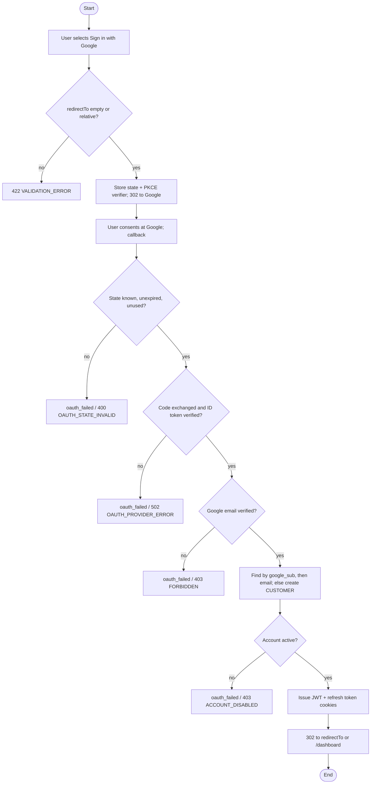

## 6.4 OAuth 2.0 Login with Google

**Actor:** any visitor with a Google account. **Service:** Identity. **API:** v1.1 sections 2.5 and 2.6.
**Tables:** `identity.oauth_states`, `identity.users`, `identity.refresh_tokens` (Database Design v1.1 sections 3.2, 3.4 and 3.5).

Google sign-in uses the OAuth 2.0 authorization code flow with PKCE and OpenID Connect. Google only proves who the user is. SwiftDrop then issues its own session, exactly as email login does, so every other service keeps trusting one token format. Figure 14 shows the message flow and Figure 15 the decisions. The draw.io sources are `docs/diagrams/figure-14-google-login-sequence.drawio` and `docs/diagrams/figure-15-google-login-activity.drawio`.

### 6.4.1 Step by step

The step numbers below are the numbers in Figure 14.

1. The browser opens `GET /auth/google/login`, optionally with `redirectTo` (for example `/dashboard`).
2. Identity checks that `redirectTo` is a safe relative path (otherwise `422 VALIDATION_ERROR`), then stores a random `state`, a PKCE verifier and the `redirectTo` in `oauth_states`. The row expires after about 10 minutes.
3. Identity answers `302` to Google's consent URL with `client_id`, `redirect_uri`, `response_type=code`, `scope=openid email profile`, the `state` and the PKCE `code_challenge` (method `S256`).
4. The user signs in and consents at Google.
5. Google redirects the browser to `/auth/google/callback` with a `code` and the `state`. If the user refuses, Google sends `error` and no `code`.
6. The browser requests `GET /auth/google/callback?code=...&state=...`.
7. Identity validates and consumes the `state` in a single statement. An unknown, expired or already used state is refused (`400 OAUTH_STATE_INVALID` when called directly).
8. Identity sends the `code` and the PKCE verifier to Google's token endpoint.
9. Google returns tokens, including an ID token.
10. Identity verifies the ID token (signature, issuer, audience, expiry) and requires Google to report the email as verified. It then finds the user by `google_sub`, otherwise by email (linking the Google account), otherwise creates a `CUSTOMER`. A disabled account is refused.
11. Identity answers `302` to `redirectTo` or `/dashboard` and sets the HttpOnly cookies `sd_access` and `sd_refresh`. Google's tokens are discarded.

Any failure from step 6 on redirects the browser to `/login?error=oauth_failed` and sets no cookies. A caller that sends `Accept: application/json` (and not `text/html`) receives the JSON error instead.

```mermaid
sequenceDiagram
    autonumber
    participant B as Browser
    participant I as Identity service
    participant G as Google
    B->>I: GET /auth/google/login?redirectTo=/path
    Note over I: check redirectTo; store state + PKCE verifier (about 10 min)
    I-->>B: 302 to Google (state, code_challenge)
    B->>G: sign in and consent
    G-->>B: 302 to callback (code, state)
    B->>I: GET /auth/google/callback?code&state
    Note over I: validate and consume state (works once)
    I->>G: exchange code + PKCE verifier
    G-->>I: ID token
    Note over I: verify ID token; google_sub, then email, or create CUSTOMER
    I-->>B: 302 to redirectTo or /dashboard, Set-Cookie sd_access, sd_refresh
```

**Figure 14: Sequence diagram, OAuth 2.0 login with Google.** (Mermaid preview; the draw.io file is the editable source.)



**Figure 15: Activity diagram, OAuth 2.0 login with Google.** (`oauth_failed` stands for the redirect to `/login?error=oauth_failed`; the code applies when the endpoint is called directly.)

### 6.4.2 Account matching

| Situation                                              | What Identity does                                                                                                                                                                  |
| :----------------------------------------------------- | :---------------------------------------------------------------------------------------------------------------------------------------------------------------------------------- |
| A user already has this `google_sub`                   | Sign that user in. The email is not compared again, so a changed Google email cannot create a second account.                                                                       |
| No `google_sub`, but a user has the same email         | Link: store `google_sub`, set `email_verified = true`, and keep the user's role, `auth_provider` and any password. The user can then use either login. A disabled user is not linked. |
| Neither exists                                         | Create a `CUSTOMER` with `auth_provider = GOOGLE`, `password_hash = NULL`, `email_verified = true`, no phone, and the Google name (or the part of the email before `@` if the name is missing). |
| The email is already linked to a different Google account | Refused as a provider error. A SwiftDrop account is never moved to another Google identity.                                                                                         |

Email is compared without regard to letter case, as everywhere else (unique index on `lower(email)`).

### 6.4.3 Outcomes and error codes

| Outcome                                   | Browser (default)                       | Called directly (`Accept: application/json`) |
| :---------------------------------------- | :-------------------------------------- | :------------------------------------------- |
| Success                                   | `302` to `redirectTo` or `/dashboard`   | the same `302` and cookies                   |
| `redirectTo` is not a relative path       | `422 VALIDATION_ERROR` on the first call (before Google) | `422 VALIDATION_ERROR`      |
| State missing, unknown, expired or reused | `302 /login?error=oauth_failed`         | `400 OAUTH_STATE_INVALID`                    |
| Google refused, code rejected, bad ID token, no code | `302 /login?error=oauth_failed` | `502 OAUTH_PROVIDER_ERROR`                  |
| Google email not verified                 | `302 /login?error=oauth_failed`         | `403 FORBIDDEN` (not listed in API v1.1)     |
| Account disabled                          | `302 /login?error=oauth_failed`         | `403 ACCOUNT_DISABLED`                       |
| More than 10 requests per minute per address | `429 RATE_LIMITED`                   | `429 RATE_LIMITED`                           |
| Google settings missing                   | the routes do not exist (`404 NOT_FOUND`) | the same                                   |

### 6.4.4 Design decisions and the reason for each

| Decision                                                                                  | Reason                                                                                                                                                                                                  |
| :---------------------------------------------------------------------------------------- | :------------------------------------------------------------------------------------------------------------------------------------------------------------------------------------------------------ |
| `state` is 32 bytes from the system random generator, stored server-side, used once        | It ties the callback to a login this server started, which stops login CSRF. Deleting it in one statement means two simultaneous callbacks cannot both succeed, and a replay fails.                       |
| The state is consumed **before** the code is exchanged                                    | A failed login cannot be retried with the same state, so a leaked callback URL is worthless after the first attempt.                                                                                    |
| PKCE (`S256`) is always used, with the verifier kept in `oauth_states.code_verifier`       | A stolen authorization code cannot be exchanged without the verifier, which never leaves the server. The table already has the column (Database Design 3.5: "PKCE verifier if used").                    |
| The ID token is verified against Google's published keys, issuer and our client ID         | It proves the token was issued by Google to SwiftDrop and has not expired. Using the library's verifier avoids hand-written signature code.                                                             |
| Google must report `email_verified = true`                                                | Linking by email is only safe when Google vouches for the address; otherwise someone could claim another person's account with an unverified Google email.                                              |
| Matching is `google_sub` first, then email                                                | `sub` never changes for a Google account, while an email can. The email fallback lets an existing email-and-password customer start using Google without a second account (API v1.1 2.6).               |
| New users are always `CUSTOMER`                                                           | Staff accounts are created only by an administrator (API 2.11); a public sign-in must never confer a privileged role.                                                                                    |
| `redirectTo` must be a relative path: starts with `/`, not `//`, no `\`, no spaces or control characters, at most 255 characters | An absolute or protocol-relative URL would turn the login into an open redirect to a phishing site. It is checked when the login starts, again at the callback, and the database also has a `CHECK` constraint. |
| SwiftDrop's own tokens are issued; Google's are dropped                                    | One session format for all login methods; no Google token is ever stored, so nothing Google-side can be leaked from our database.                                                                       |
| The same session code as email login is reused                                            | Cookies, token lifetimes and refresh-token storage stay identical, so logout, refresh and deactivation work the same for Google users.                                                                  |
| Failures redirect to `/login?error=oauth_failed` with no detail                           | The user needs only to know it failed; details (and any Google error text) stay in server logs, which never contain the code, state or tokens.                                                          |
| 10 requests per minute per address on both endpoints                                      | The login endpoint writes a row per call; the limit stops an anonymous caller filling the table. API v1.1 section 1.7 sets no specific figure for these endpoints, so this uses the login figure.        |
| The Google routes exist only when `GOOGLE_CLIENT_ID`, `GOOGLE_CLIENT_SECRET` and `GOOGLE_REDIRECT_URI` are all set | Google sign-in is optional. The service and CI start without it, and a clear warning names the missing settings (never their values).                                          |
| Expired states are deleted each time a login starts                                       | Abandoned attempts do not pile up (Database Design recommends a clean-up of expired `oauth_states`), without needing a separate scheduled job.                                                         |

### 6.4.5 What was checked

Run with `go test ./apps/services/identity/...` (all pass). The SQL tests marked ◇ are written but need PostgreSQL (`TEST_DATABASE_URL`) and have not been run yet.

| Requirement (task sheet M3.1 test)             | Test                                                                                                                          |
| :--------------------------------------------- | :---------------------------------------------------------------------------------------------------------------------------- |
| A new Google user becomes a CUSTOMER           | `TestGoogleAuth_CompleteGoogleLogin_createsCustomer`; ◇ `TestRepository_CreateGoogleUser`                                      |
| A reused or wrong state is refused             | `TestGoogleAuth_CompleteGoogleLogin_stateIsSingleUse`, `_rejectsBadState`; ◇ `TestRepository_ConsumeOAuthState_*` (including 8 simultaneous callbacks) |
| Only relative redirect paths are allowed       | `TestValidRedirectPath` (absolute, `//`, `\`, control characters, length), `TestGoogleCallback_neverRedirectsOffSite`          |
| ID token must be genuine                       | `internal/google` tests: wrong audience, wrong issuer, expired, unknown signing key, missing token, PKCE verifier sent        |
| Existing accounts and disabled accounts        | `_existingGoogleSub`, `_linksExistingEmailAccount`, `_linkConflict`, `_disabledAccount`; ◇ `TestRepository_LinkGoogleAccount`  |
| Cookies and redirects                          | `TestGoogleCallback_success` (HttpOnly, paths, no tokens in the body), `_browserFailuresRedirectToLogin`                      |
| Nothing sensitive in logs                      | `TestGoogleCallback_logsNeverContainCredentials`                                                                              |
| Login works from M2's login page               | **Not yet tested**: needs the stack running in Docker with real Google credentials and the Google button from M2.             |

### 6.4.6 Differences from the draft in Design Report v1.1, and known limits

- The draft said the PKCE verifier was stored "if used"; it is now always used.
- The draft listed no check of the Google email. Verification is now required (decision above).
- The draft listed two failure branches; the built flow has four (state, Google exchange, unverified email, disabled account). All redirect to the same URL.
- The step numbers now match Figure 14 (11 steps); the draft text used 6 steps against an 11-step figure.
- An existing account that was registered with a password but whose email was never verified becomes linked on the first Google login. If an attacker had pre-registered the victim's email with their own password, that password would keep working after the real owner links Google. Revoking the account's existing sessions on first link would remove this risk; it is not done, because API v1.1 2.6 only specifies the match.
- A user's access token stays valid until it expires (15 minutes by default) even if the account is disabled meanwhile; refresh stops immediately.
