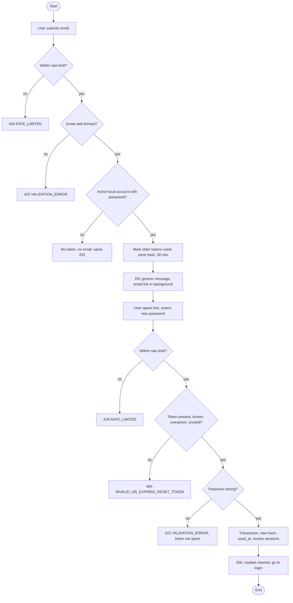

## 6.5 Password Reset

**Actor:** a user who has forgotten their password. **Service:** Identity, with the shared mailer (`packages/go-common/mailer`). **API:** v1.1 sections 2.16 and 2.17.
**Tables:** `identity.password_reset_tokens`, `identity.users`, `identity.refresh_tokens` (Database Design v1.1 sections 3.4 and 3.7).

A user asks for a reset link by email, opens it, and chooses a new password. The link carries a random token that works once and expires after the configured `PASSWORD_RESET_TOKEN_TTL` (default 30 minutes). The service never reveals whether an email belongs to an account. Figure 16 shows the message flow and Figure 17 the decisions. The draw.io sources are `docs/diagrams/figure-16-password-reset-sequence.drawio` and `docs/diagrams/figure-17-password-reset-activity.drawio`.

### 6.5.1 Step by step

The step numbers below are the numbers in Figure 16.

1. The user selects **Forgot password** and the page sends `POST /auth/forgot-password` with the email.
2. Identity applies the rate limits (per client address and per email). If the email belongs to an **active local account that has a password**, Identity generates a random token, then in one transaction marks the user's earlier unused tokens as used and stores the SHA-256 hash of the new token with the configured `PASSWORD_RESET_TOKEN_TTL` expiry (default 30 minutes). Otherwise it does nothing.
3. Identity answers `202` with the same message for every well-formed email: "If an account exists for this email, a password reset link will be sent."
4. In the background, Identity sends the email through the shared SMTP mailer (Mailpit in development). The link is `FRONTEND_BASE_URL/reset-password?token=...`.
5. The email arrives and the user opens the link. The reset page reads the token from the URL and asks only for a new password.
6. The page sends `POST /auth/reset-password` with `token` and `newPassword`.
7. Identity checks the token first: it must be present, its hash must exist, be unexpired and unused, and belong to an active user. Only then does it check the new password against the strength rules.
8. In one transaction Identity stores the new password hash, sets `used_at`, clears any login lock and revokes every active refresh token of the user.
9. Identity answers `200` and clears the session cookies. The page sends the user to log in.

```mermaid
sequenceDiagram
    autonumber
    participant B as Browser
    participant I as Identity service
    participant E as Email service (SMTP)
    B->>I: POST /auth/forgot-password {email}
    Note over I: rate limit; if active local account with password: mark older tokens used, store token hash, 30 min
    I-->>B: 202 same message for every email
    I--)E: send reset link (background)
    E--)B: email delivered; user opens /reset-password?token=...
    B->>I: POST /auth/reset-password {token, newPassword}
    Note over I: check token (hash, expiry, used_at), then password rules
    Note over I: one transaction: new hash, used_at, clear lock, revoke refresh tokens
    I-->>B: 200, cookies cleared; go to login
```

**Figure 16: Sequence diagram, password reset.** (Mermaid preview; the draw.io file is the editable source.)



**Figure 17: Activity diagram, password reset.**

### 6.5.2 Rules

| Rule                      | Value                                                                                                                                          |
| :------------------------ | :--------------------------------------------------------------------------------------------------------------------------------------------- |
| Token                     | 32 bytes from the system random generator, shown as 43 URL-safe characters. Only its SHA-256 hash (64 hex characters) is stored.              |
| Lifetime                  | `PASSWORD_RESET_TOKEN_TTL` (default 30 minutes; 5m to 24h). A token is valid only while `used_at` is empty and the time is before `expires_at`. |
| One live link             | Requesting a new link marks the earlier unused tokens used, so only the newest works. The database also enforces one unused token per user.   |
| Who gets a link           | A user that exists, is active and has a password. Google-only and disabled accounts get nothing, but the same `202` is returned.               |
| Link                      | Built from the configured `FRONTEND_BASE_URL`, never from the request's `Host` header.                                                          |
| New password             | The registration rules: at least 8 characters, an upper case letter, a lower case letter and a digit, at most 72 bytes.                         |
| Rate limits               | `forgot-password`: 5 per minute per client address **and** 5 per minute per email. `reset-password`: 5 per minute per client address.          |
| After a reset             | New password stored as a bcrypt hash, token spent, login lock cleared, every refresh token revoked, cookies cleared.                            |

### 6.5.3 Outcomes and error codes

| Request                | Outcome                                                         | Status and code                          |
| :--------------------- | :-------------------------------------------------------------- | :--------------------------------------- |
| `forgot-password`      | Any well-formed email, known or not                             | `202` with the generic message           |
|                        | Email missing or malformed                                      | `422 VALIDATION_ERROR`                   |
|                        | Too many requests                                               | `429 RATE_LIMITED` with `Retry-After`    |
|                        | Malformed JSON                                                  | `400 BAD_REQUEST`                        |
|                        | Database failure                                                | `500 INTERNAL_ERROR`                     |
| `reset-password`       | Success                                                         | `200`, "Password has been reset successfully." |
|                        | Token missing, unknown, expired, already used, or user disabled | `400 INVALID_OR_EXPIRED_RESET_TOKEN`, one message for all causes (checked first) |
|                        | Valid token but the password breaks the rules                   | `422 VALIDATION_ERROR` (the token is not spent) |
|                        | Too many requests                                               | `429 RATE_LIMITED`                       |

There is no distinct response for an unknown email. A mail-server outage is also invisible to the caller: it is logged with the user ID only (never the address, link or token).

### 6.5.4 Design decisions and the reason for each

| Decision                                                                                  | Reason                                                                                                                                                                                                     |
| :---------------------------------------------------------------------------------------- | :--------------------------------------------------------------------------------------------------------------------------------------------------------------------------------------------------------- |
| Always `202` with one message                                                              | Prevents user enumeration: an attacker cannot learn which emails are registered (API v1.1 2.16).                                                                                                           |
| The email is sent in the background, after the reply is prepared                           | The reply time then does not depend on how long the mail server takes, which would otherwise reveal whether an email was sent.                                                                             |
| Only the SHA-256 hash of the token is stored                                              | A database leak or backup does not hand out working reset links. SHA-256 is enough for a 256-bit random token; a slow password hash is needed only for guessable secrets.                                  |
| 32 random bytes                                                                            | 256 bits cannot be guessed. The 5-per-minute limit adds a second barrier.                                                                                                                                  |
| Configurable lifetime (default 30 minutes), single use                                    | Limits the window if the mailbox is read by someone else, and a spent link is useless (API v1.1 2.17).                                                                                                     |
| Older unused tokens are marked used before the new one is inserted, in one transaction with the user row locked | Only the newest link works. The lock stops two simultaneous requests from both inserting an unused token and hitting the database's one-unused-token index.                       |
| The password change, `used_at` and the session revocation are one transaction             | A crash cannot leave the password changed but the token reusable, or old sessions alive. The token row is locked, so two requests with the same token cannot both succeed.                                  |
| All refresh tokens are revoked                                                            | Whoever knew the old password (the usual reason for a reset) loses their sessions. An access token already issued stays valid until it expires (15 minutes by default).                                    |
| The login lock is cleared                                                                 | A user locked out by failed attempts, who then proves control of the mailbox, should be able to sign in with the new password.                                                                             |
| Google-only accounts silently get no token                                                | They have no password to reset (API v1.1 `PASSWORD_NOT_SET`), and a visible refusal would reveal that the account exists and how it signs in.                                                              |
| Links come from `FRONTEND_BASE_URL`                                                       | A forged `Host` header cannot make the emailed link point at an attacker's site.                                                                                                                            |
| One message for every bad token                                                           | The caller cannot tell an expired token from a spent or invented one, so tokens cannot be probed.                                                                                                          |
| The token is checked first and the password second, as API v1.1 2.17 lists them; a bad token is refused before the password is hashed | A weak password with a valid token returns `422` and leaves the link usable so the user can try again. A request with a bad token gets the same `400` whatever the password is, and cannot make the server spend time on bcrypt. The final spend repeats the token check under a lock, so the read-only first check is never trusted for the change. |
| The shared mailer verifies TLS certificates and refuses to send credentials without TLS   | A Gmail App Password must never cross the network in clear text. Mailpit needs no login, so it works over plain SMTP locally.                                                                              |
| The routes exist only when SMTP and `FRONTEND_BASE_URL` are configured                    | Without a mail server the feature cannot work; a clear startup warning is better than accepting requests that silently send nothing.                                                                       |
| The raw token is never logged, returned or stored                                         | Database Design 3.7: it exists only in the emailed link.                                                                                                                                                    |

### 6.5.5 What was checked

Executed locally with `go test` and `go test -race` for the identity and mailer packages, and with `go test -tags=integration` against PostgreSQL 14.17 using `TEST_DATABASE_URL` (isolated databases). The new commit has not been pushed, so CI for it has not run. Tests marked ◇ are PostgreSQL integration tests and ran locally. Mailpit delivery and browser-level reset remain unverified.

| Requirement (task sheet M3.3 test)                   | Test                                                                                                                                                   |
| :--------------------------------------------------- | :----------------------------------------------------------------------------------------------------------------------------------------------------- |
| An unknown email gets the same reply                 | `TestPasswordReset_ForgotPassword_sameOutcomeForEveryEmail` (unknown, Google-only, disabled), `TestForgotPassword_replyDoesNotDependOnTheAccount`        |
| Token stored only as a hash, configured expiry        | `TestPasswordReset_ForgotPassword_sendsLinkAndStoresOnlyAHash`, `TestPasswordReset_ForgotPassword_persistsUTCTimestamps`                                      |
| Reset lifetime comes from configuration and persists in UTC | `TestPasswordReset_ForgotPassword_persistsUTCTimestamps`; ◇ `TestPasswordResetFlow_persistsConfiguredTTL` |
| Older links stop working                             | `TestPasswordReset_newestLinkOnly`; ◇ `TestRepository_IssuePasswordResetToken_onlyTheNewestWorks`, `_concurrentRequestsLeaveOneUnusedToken`             |
| The link works once                                  | `TestPasswordReset_ResetPassword_worksOnce`; ◇ `TestRepository_ResetPasswordWithToken_concurrentUseSucceedsOnce`                                         |
| An expired or used link returns 400                  | `_expired`, `_stillValidJustBeforeExpiry`, `TestResetPassword_errors`, `TestResetPassword_sameMessageForEveryBadToken`; ◇ `_rejectsBadTokens`           |
| A reset logs out all sessions                        | `TestResetPassword_success` (cookies cleared); ◇ `TestRepository_ResetPasswordWithToken_changesPasswordAndEndsSessions` (other users untouched)          |
| A reset restores password login after Google linking | ◇ `TestRepository_LinkGoogleAccount_thenPasswordResetRestoresPassword`, `TestGoogleFlow_passwordResetRestoresPasswordAfterLinking`                        |
| Weak password does not spend the token               | `TestPasswordReset_ResetPassword_validation`                                                                                                            |
| Token checked before password (API 2.17 order)      | `TestPasswordReset_ResetPassword_tokenIsCheckedBeforeThePassword`, `_neverHashesForABadToken`; ◇ `TestRepository_PasswordResetTokenUsable`                 |
| Rate limits                                          | `TestForgotPassword_rateLimitedPerIP`, `_rateLimitedPerEmailAcrossAddresses`, `TestResetPassword_rateLimitedPerIP`                                      |
| No token, address or link in logs                    | `TestPasswordReset_logsNeverContainTokensOrEmails`                                                                                                      |
| Mailer: TLS, credentials, injection                  | `packages/go-common/mailer` tests: plain server, STARTTLS with verification, no credentials without TLS, header injection, multipart        |
| **The reset email appears in Mailpit**               | **Not yet tested**: needs Docker Compose with Mailpit running. The mailer was tested only against an in-process fake SMTP server.                      |

### 6.5.6 Differences from the draft in Design Report v1.1, and known limits

- Step order in Figure 16 changed: the `202` reply (step 3) now comes before the email is sent (step 4), because delivery happens in the background. The draft sent first and replied second.
- The validation order follows API v1.1 2.17 and the draft Figure 17 (token, then password).
- The draft's Figure 17 had one rate-limit decision; the built flow limits both endpoints, and `forgot-password` also per email.
- The step numbers now match Figure 16 (9 steps).
- "Local account with a password" in the draft is now precisely "active local account with a password".
- Request time still differs by a few milliseconds between a known and an unknown email (the known one writes a row). The email delivery time, the large difference, is hidden.
- The recommended daily clean-up of expired reset tokens (Database Design v1.1, section 11) is not built; expired rows are harmless because the token check uses `expires_at`.
- A password reset is also the recovery path after a Google link clears the password of an unverified existing account. Once the reset succeeds, password login works again; the account stays linked to the Google identity.
