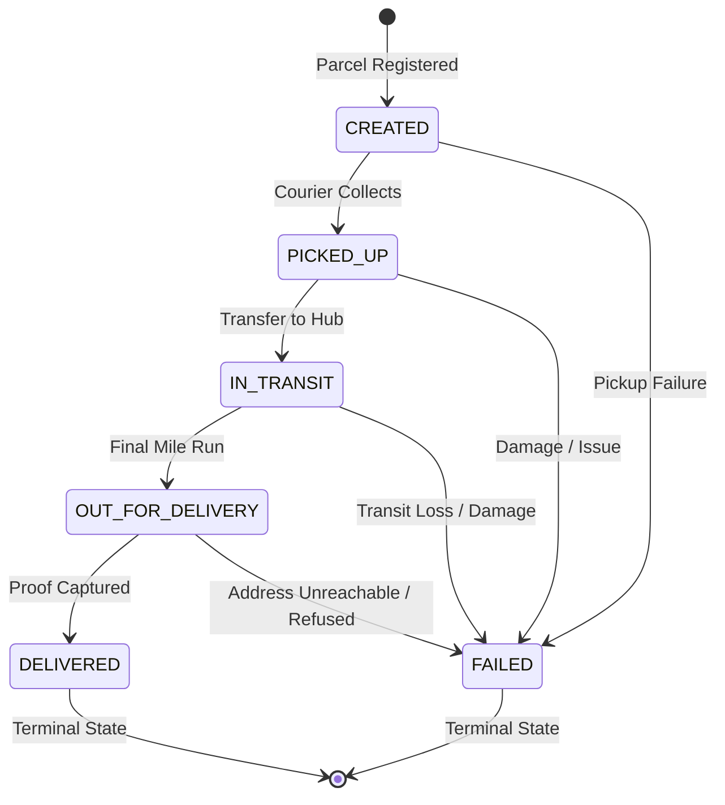

## 6.6 Parcel Status State Machine

The parcel lifecycle is governed by a deterministic finite state machine implemented within the Parcel Operations service (`apps/services/parcel/internal/statemachine`) and enforced at both the application domain and database schema levels.

### 6.6.1 Status Lifecycle Diagram

### 6.6.2 State Transition Matrix

Table 6.6 specifies the valid transitions, terminal states, and transition prerequisites:

| Current Status (`from`) | Allowed Next Status (`to`) | Terminal? | Pre-conditions and Required Input |
| :--- | :--- | :--- | :--- |
| `CREATED` | `PICKED_UP`, `FAILED` | No | Parcel registered and assigned to courier. For `FAILED`, `failure_reason` (5–255 chars) is mandatory. |
| `PICKED_UP` | `IN_TRANSIT`, `FAILED` | No | Courier has accepted physical custody. For `FAILED`, `failure_reason` (5–255 chars) is mandatory. |
| `IN_TRANSIT` | `OUT_FOR_DELIVERY`, `FAILED` | No | Parcel transported between facilities. For `FAILED`, `failure_reason` (5–255 chars) is mandatory. |
| `OUT_FOR_DELIVERY` | `DELIVERED`, `FAILED` | No | Parcel on final-mile delivery run. For `DELIVERED`, `recipient_name` (non-empty, max 150 chars) is mandatory. For `FAILED`, `failure_reason` (5–255 chars) is mandatory. |
| `DELIVERED` | None | Yes | Successfully handed over to recipient. No further transitions permitted. |
| `FAILED` | None | Yes | Delivery aborted due to failure condition. No further transitions permitted. |

### 6.6.3 Business and Validation Rules

1. **Role and Ownership Enforcement (API 6.3):**
   - **Only the courier currently assigned to the parcel (`parcel.current_courier_id == actor_user_id`) can change its status (API 6.3)**.
   - Dispatchers and admins manage courier assignments (`POST /api/v1/dispatch/assign`), but **cannot change parcel status**. Any attempt by an unassigned courier, customer, merchant, or dispatcher to trigger a status transition returns HTTP `403 FORBIDDEN`.

2. **Transition Validation Rules:**
   - Any attempt to transition outside the permitted paths (e.g., `CREATED -> DELIVERED`, backward step `IN_TRANSIT -> PICKED_UP`, or self-transition `IN_TRANSIT -> IN_TRANSIT`) returns HTTP `409 INVALID_TRANSITION`.
   - Any transition out of a terminal state (`DELIVERED` or `FAILED`) returns HTTP `409 INVALID_TRANSITION`.
   - Transitioning to `DELIVERED` requires a valid non-empty `recipient_name` (up to 150 characters). Missing or whitespace-only recipient returns HTTP `422 RECIPIENT_REQUIRED`.
   - Transitioning to `FAILED` requires a descriptive `failure_reason` between 5 and 255 characters. Missing, whitespace-only, or length-violating reason returns HTTP `422 FAILURE_REASON_REQUIRED`.
   - An optional `note` is supported up to 500 characters. Exceeding 500 characters returns HTTP `422 VALIDATION_ERROR`.

3. **Courier Assignment Eligibility (API 5.2):**
   - A parcel in `DELIVERED` or `FAILED` status is considered closed (`IsClosed() == true`).
   - A `DELIVERED` or `FAILED` parcel **cannot be assigned or reassigned** to any courier. Attempting to assign a closed parcel returns HTTP `409 PARCEL_CLOSED`.

4. **Transactional Outbox Guarantee:**
   - Every status transition atomically inserts an append-only row into `parcel.parcel_status_history` and a corresponding event into `parcel.outbox_events` (`routing_key = 'parcel.status.changed'`, `event_type = 'parcel.status_changed'`) within the same database transaction, ensuring at-least-once asynchronous event delivery over RabbitMQ `swiftdrop.events`.

