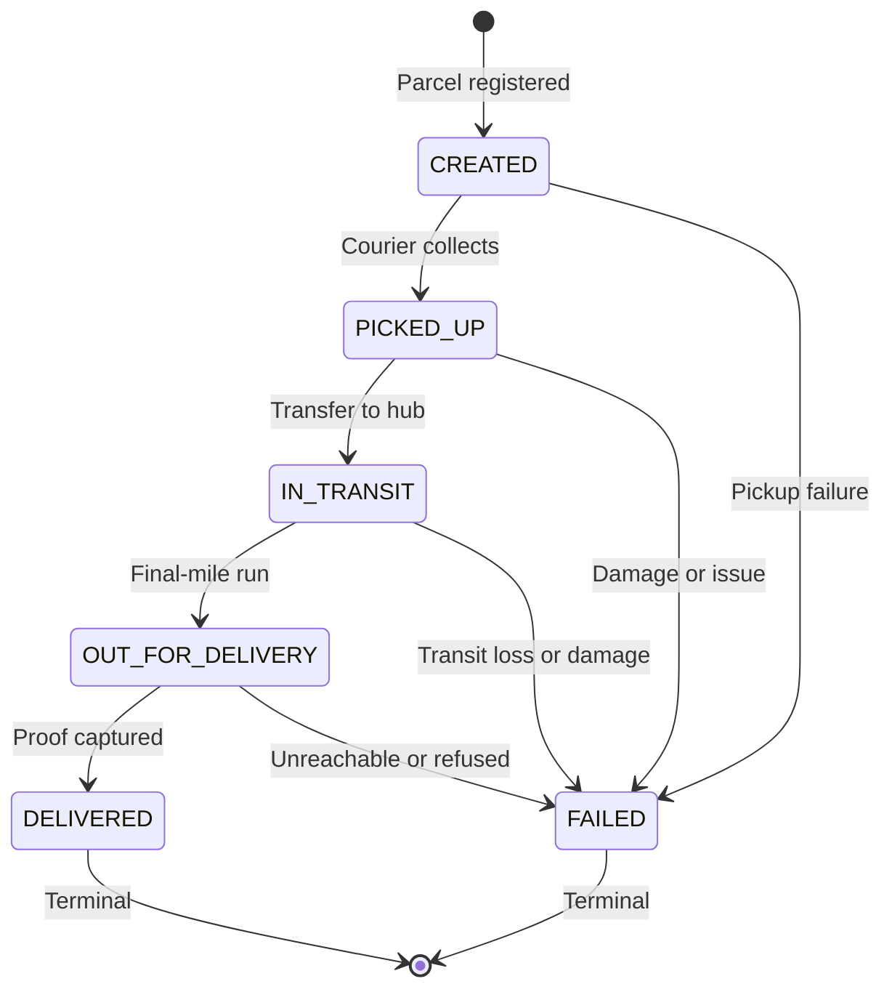

## 6.6 Parcel Status State Machine

The parcel lifecycle is a deterministic finite state machine. The domain rules live in `apps/services/parcel/internal/statemachine`, independent of HTTP handlers and database code. The PostgreSQL schema independently rejects invalid status changes through the `parcel.enforce_status_transition()` trigger.

### 6.6.1 Status Lifecycle

### 6.6.2 State Transition Matrix

Table 6.6 lists the permitted transitions and the input required for each destination state.

| Current status (`from`) | Allowed next status (`to`)   | Terminal? | Preconditions and required input                                                                                                        |
| :---------------------- | :--------------------------- | :-------- | :-------------------------------------------------------------------------------------------------------------------------------------- |
| `CREATED`               | `PICKED_UP`, `FAILED`        | No        | Parcel registered. `FAILED` requires a failure reason of 5 to 255 characters.                                                           |
| `PICKED_UP`             | `IN_TRANSIT`, `FAILED`       | No        | Courier has physical custody. `FAILED` requires a failure reason of 5 to 255 characters.                                                |
| `IN_TRANSIT`            | `OUT_FOR_DELIVERY`, `FAILED` | No        | Parcel is moving between facilities. `FAILED` requires a failure reason of 5 to 255 characters.                                         |
| `OUT_FOR_DELIVERY`      | `DELIVERED`, `FAILED`        | No        | Parcel is on its final-mile run. `DELIVERED` requires a non-empty recipient name of at most 150 characters. `FAILED` requires a reason. |
| `DELIVERED`             | None                         | Yes       | Successfully handed over. No further transitions are permitted.                                                                         |
| `FAILED`                | None                         | Yes       | Delivery aborted. No further transitions are permitted.                                                                                 |

### 6.6.3 Domain Validation

`ValidateTransition` implements the matrix and returns structured `statemachine.DomainError` values. `errors.Is` matches dynamic errors against the sentinel errors by API error code.

| Condition                                                              | Code                      | HTTP status |
| :--------------------------------------------------------------------- | :------------------------ | :---------- |
| Unknown or empty source or destination status                          | `VALIDATION_ERROR`        | 422         |
| Prohibited, backward, skipped, identical, or terminal-state transition | `INVALID_TRANSITION`      | 409         |
| `DELIVERED` without a non-empty recipient name                         | `RECIPIENT_REQUIRED`      | 422         |
| Recipient name longer than 150 characters                              | `VALIDATION_ERROR`        | 422         |
| `FAILED` without a reason of 5 to 255 characters                       | `FAILURE_REASON_REQUIRED` | 422         |
| Note longer than 500 characters                                        | `VALIDATION_ERROR`        | 422         |
| Assignment or reassignment of a terminal parcel                        | `PARCEL_CLOSED`           | 409         |
| Status update by a courier other than the assigned courier             | `FORBIDDEN`               | 403         |

Length limits are measured in Unicode code points, matching PostgreSQL `VARCHAR` semantics.

The package exposes:

- `AllStatuses()` and `AllowedNext(status)` as defensive copies of the canonical collections.
- `IsValidStatus`, `IsTerminal`, and `IsClosed`.
- `CanTransition` for transition checks without input validation.
- `ValidateTransition` for transition plus recipient, failure-reason, and note validation.
- `CanAssignCourier` for dispatch eligibility.
- `VerifyCourierOwnership` and `ValidateCourierTransition` for the courier workflow.

### 6.6.4 Database Alignment

The baseline migration `000002_tables` already creates the parcel tables. It also installs:

- `parcel.enforce_status_transition()`, a `BEFORE UPDATE OF status` trigger that raises SQLSTATE `23514` for any status change outside the matrix. A same-status `UPDATE` does not fire the trigger because it is not a transition.
- `parcel.forbid_history_change()`, an append-only trigger on `parcel.parcel_status_history`.
- `assignments_one_current_uq`, a partial unique index on `parcel.parcel_assignments (parcel_id) WHERE is_current`.
- `assignments_courier_idx`, a workload index on `parcel.parcel_assignments (courier_id, is_current)`.
- `outbox_status_created`, an index on `parcel.outbox_events (status, created_at)` for pending-event retrieval.

Migration `000003_dispatch_foundations` extends, but does not recreate, those tables:

- `parcel_assignments.previous_courier_id` records the courier replaced by a reassignment for API 5.2.
- `parcel_assignments.updated_at` and its `set_updated_at` trigger make assignment closure auditable.
- `outbox_events.aggregate_type` and `outbox_events.aggregate_id` let a future relay group events by aggregate, with `outbox_aggregate_pair` enforcing that both are set or both are null and `outbox_aggregate_idx` supporting aggregate queries.

### 6.6.5 Outbox Behavior

`parcel.outbox_events` is the transactional outbox foundation, not a RabbitMQ queue. Each row stores:

- `id`, which is also the event ID used for consumer idempotency.
- `event_type` and `routing_key`. API v1.1 section 11.3 uses `parcel.status_changed` as the event type and `parcel.status.changed` as the routing key; `outbox_type_key_pair` enforces the pairing.
- `payload`, a JSONB event body that must not contain addresses, phone numbers, tokens, or photos.
- `status` (`PENDING`, `PUBLISHED`, `FAILED`), `attempts`, `last_error`, `created_at`, and `published_at`.
- Optional aggregate metadata added by `000003_dispatch_foundations`.

The outbox writer, publisher, relay, and retry loop are **planned**. No producer publishes events in Milestone 1, and the current workers do not consume parcel events. The event envelope and versioned `contracts/events` conventions must be reconciled with API v1.1 before the relay is implemented.

### 6.6.6 Implementation Status

| Capability                                                     | Status      |
| :------------------------------------------------------------- | :---------- |
| Canonical statuses and transition matrix                       | Implemented |
| Domain transition, input, ownership, and assignment validation | Implemented |
| PostgreSQL status, assignment, and outbox schema               | Implemented |
| Database transition trigger and append-only history            | Implemented |
| Courier and dispatch HTTP handlers                             | Planned     |
| Assignment repository and identity eligibility check           | Planned     |
| Outbox writer, relay, and RabbitMQ producer                    | Planned     |
| Real-time status broadcasts                                    | Planned     |

### 6.6.7 Coordination with Other Members

- **Member 5 (parcel model):** the canonical status values are the database `parcels.status` values and the constants in `statemachine`. The parcel model must reuse those values and must not introduce a second status type.
- **Member 7 (courier workflow):** courier handlers should call `ValidateCourierTransition` before persisting a status change, then write the parcel update, the `parcel_status_history` row, and the outbox row in one transaction once that handler is implemented.
- **Dispatch:** assignment handlers should call `CanAssignCourier` before creating an assignment and must close the previous current assignment before inserting a new one.
